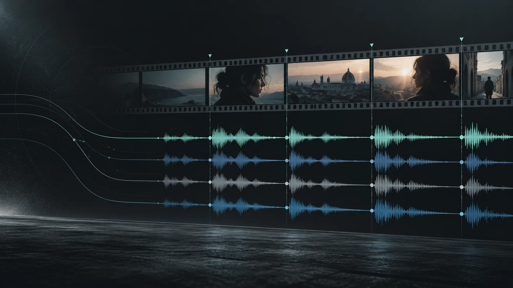
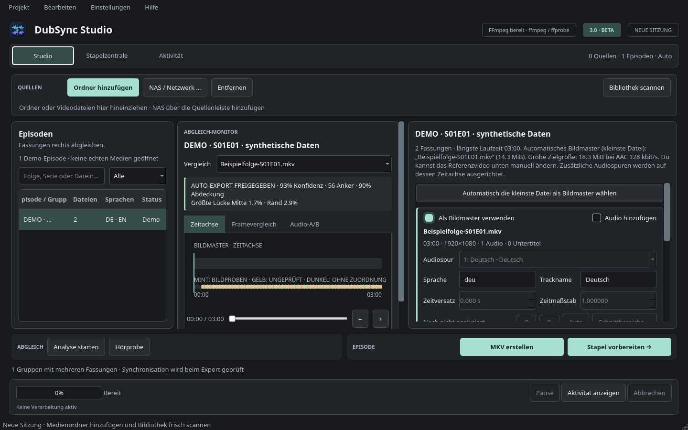
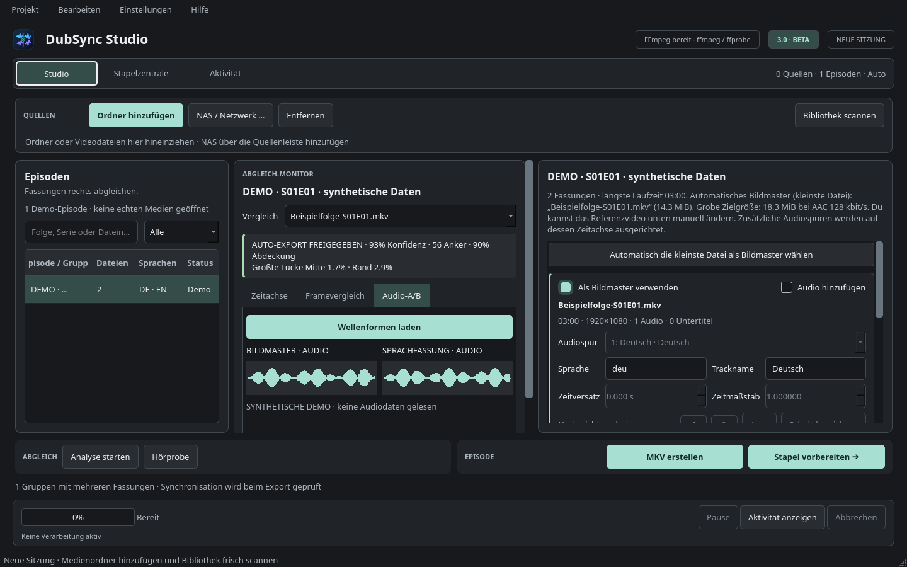
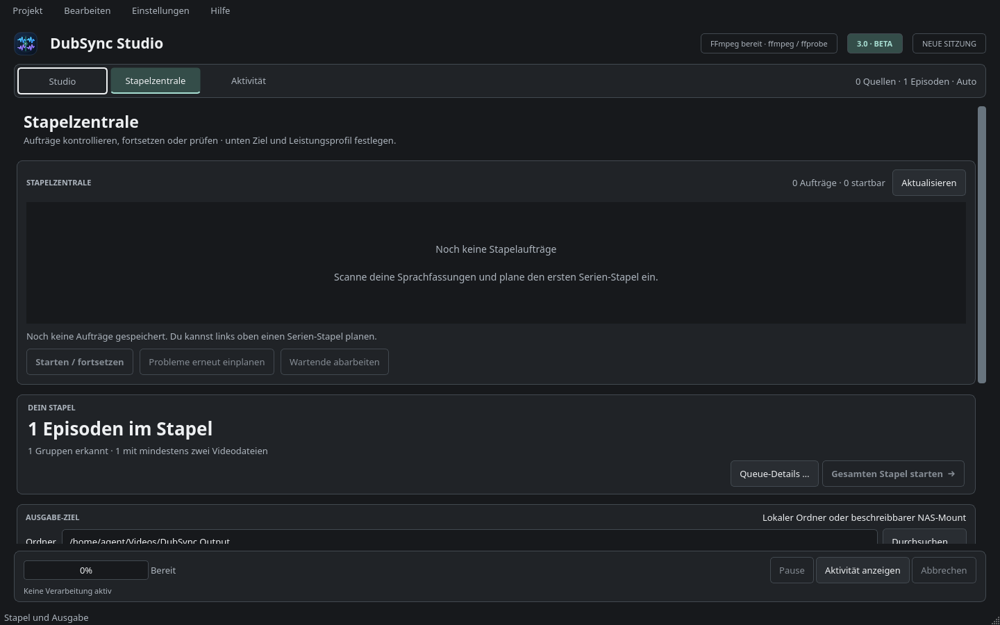
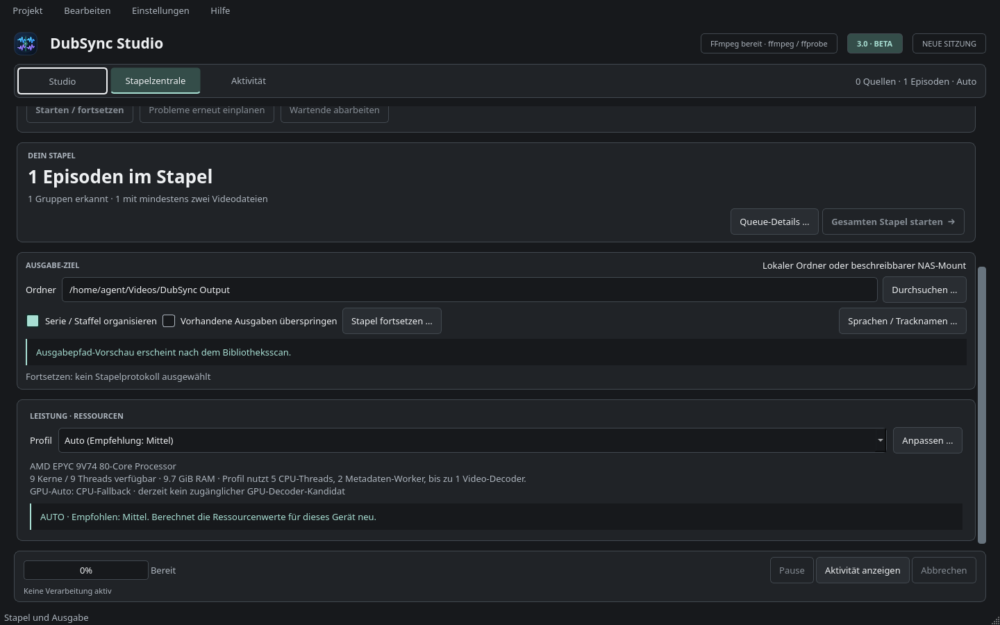

# DubSync Studio

**Synchronize multilingual video editions by their pictures, not their language.**

DubSync is a local Linux desktop app that compares visual fingerprints across
different editions of an episode, aligns the extra audio tracks, and builds a
multilingual MKV. It is designed for entire seasons, altered intros, missing
scenes, and media libraries on local disks or NAS mounts.



<sub>Concept artwork, not an application screenshot.</sub>

**Current release:** `3.0.0b1` · **Status:** beta · **Platform:** Linux desktop ·
**Stack:** Python / PySide6 / FFmpeg / OpenCV / optional Rust · **License:** MIT

## A look inside

| Visual evidence workbench | Audio A/B review |
| :---: | :---: |
|  |  |
| **Persistent batch queue** | **Hardware-aware presets** |
|  |  |

<sub>These are real Qt interface captures populated with **synthetic demonstration data**.
The waveforms are illustrative signals, not extracted from a real episode.
They do not demonstrate a completed export or measured GPU performance.</sub>

## What it does

- **Picture-based alignment:** monotone frame matching, drift correction, and
  conservative synchronization across separately verified scene segments.
- **Evidence you can inspect:** timeline markers, unverified-gap navigation,
  reasons for blocked exports, optional frame comparisons and short A/B audio
  waveforms. Audio previews never substitute for visual proof.
- **Safe multilingual export:** copies the original video and existing tracks,
  optionally adds a switchable SRT subtitle track, verifies the completed MKV,
  and never silently overwrites or edits source files.
- **Season-scale processing:** episode-identity checks, guarded recovery of
  mutually verified episode swaps, private diagnostics, a persistent job queue,
  and explicit resume/retry.
- **Hardware-aware performance:** Light / Balanced / Maximum resource presets;
  Intel iGPU, AMD and NVIDIA decoder candidates are measured against a CPU
  reference on local videos. Long H.264/H.265 videos are checked at three
  separate points, including the middle and later scenes, but candidates that
  fail the first check are eliminated before additional reads. When free RAM
  falls below 2 GiB, DubSync uses one decoder; NAS media skip extra probes.
  A manual decoder self-test is available under System Diagnostics.

## Get started

Requires **Python 3.10+**, **FFmpeg**, **FFprobe**, and a Linux desktop. Install
the media tools through your distribution first.

```bash
git clone https://github.com/CopyPasteUser/dubsync-studio.git
cd dubsync-studio
./install-wizard.sh  # guided desktop installation
```

Or run it directly without installing a desktop launcher:

```bash
./setup.sh
./run.sh
```

For a headless environment check: `./run.sh --doctor`. See
[installation details](docs/INSTALL_LINUX.md) for distribution-specific notes.

### Headless library and queue inspection

The same installation can inspect a library or queued jobs without starting Qt:

```bash
./run.sh --scan-library "/mnt/nas/series/de" --scan-library "/mnt/nas/series/en"
./run.sh --scan-library "/mnt/nas/series" --json
./run.sh --queue-status --json
```

Scanning groups editions by filename and folder metadata only; it never
decodes, synchronizes or exports media, and grouping is **not** visual proof
that two files contain the same episode. JSON scan output contains full local
file paths, so keep it private. Queue status reports counts and recent progress,
without source paths or stored failure logs; it does not start or resume jobs.

### Episode candidate explorer (visual evidence)

In the Studio inspector, select a picture master and click **Kandidaten …**
to choose up to eight other videos. DubSync ranks them by actual frame alignment,
requiring stronger evidence from separate interior episode sections before
labeling a candidate verified. Shared intros or credits alone do not qualify.
The result is **inspection-only**: nothing is reassigned, renamed, or exported.
Disconnected NAS files and decoder failures are reported as errors, **not** as
negative visual matches. On large libraries, review a small candidate set at a
time; the first pass decodes video and can take several minutes.

The same report is available without Qt:

```bash
./run.sh --explore-episode "/mnt/media/master.mkv" "/mnt/media/dub1.mkv" "/mnt/media/dub2.mkv" --json
```

Candidate indexes in the report refer to the order supplied on the command
line, even when the scorecard sorts the results. A unique verified candidate
is a review hint, **never** an export or reassignment approval.

### Optional Rust frame matcher

The video-frame sequence matcher and its bounded fallback candidate/hypothesis
scoring and long-offset verification can run in a small Rust library while all
media decoding, synchronization safety checks and the Qt interface remain
unchanged. With Rust/Cargo installed, `./setup.sh` builds it automatically;
the manual command is `./build-native.sh`. If it is absent or incompatible,
DubSync uses the original NumPy matcher. Set `DUBSYNC_NATIVE=0` before launching
to force NumPy for comparison. `--doctor` reports the active availability.
The Rust build has no third-party crates or network runtime requirement.
**Packaging note:** Universal Python wheels never bundle a platform-specific
Rust `.so`/`.dylib`/`.dll` under the misleading `py3-none-any` tag. Wheel-only
installations use the safe NumPy backend; source/desktop installations can build
their native matcher with `./build-native.sh`. CI checks wheel contents.

`./.venv/bin/python scripts/benchmark_native.py` runs deterministic 1200-frame
matching comparisons, with additional affine/offset benchmarks when the new
native symbols are available. Synthetic CI showed 10.97× for jittered affine
scoring (240 frames) and 13.50× for long-offset verification (12 shifts of
1200 frames); a simple affine case was only 1.04×. Physical hardware and
real-video benchmarks remain pending. A faster matcher does **not** imply the same
end-to-end gain: video decoding, NAS reads and FFmpeg export remain separate costs.

`./.venv/bin/python scripts/benchmark_match_pipeline.py --repeat 3 --json`
compares the **whole FFmpeg alignment** with native matching enabled versus the
Python fallback, using a temporary 60-second clip with an independent 32-second
intro (primarily exercising Rust long-offset probes/verification). The comparison
alternates backends, checks complete alignment evidence before reporting speed,
and separates decoding from matching time. Other native stages are measured by
`benchmark_native.py`.
Pass `SOURCE MASTER` to benchmark your own videos read-only. Results on short
synthetic clips or GitHub runners are not GPU/NAS throughput guarantees.

### Measure the best decoder concurrency on your machine

For the same source/master pair, measure serial against two-worker video
sampling before changing the performance preset:

```bash
./run.sh --benchmark-workers "/mnt/media/dub.mkv" "/mnt/media/master.mkv" --json
```

This **runs the full visual analysis twice** without exporting; it records the
actual decoder worker count, measured sampling time, and exact anchor/safety
parity. A 15% measured speed improvement with two *effective* workers is needed
before it suggests two. NAS and low-resource restrictions still apply, and no
settings are changed. Disk page caches, network traffic and other background
load can skew a single comparison; repeat it on representative local media.

To compare FFmpeg CPU thread counts on a *local* representative video, without
writing any settings or media:

```bash
./run.sh --benchmark-threads "/path/to/episode.mkv" --benchmark-seconds 20 --json
```

The FFmpeg decoder also respects CPU affinity and cgroup quotas automatically;
for example, a 2-CPU container cannot request 64 decoding threads even when
OpenCV sees the full host. This is a resource-safety cap, not a claim of higher
throughput on every machine.

The output measures the default plus bounded CPU thread counts in three
alternating repetitions. On videos lasting **15 minutes or longer**, it checks
**three separate windows** near the beginning, middle and end (shorter videos
use one window). Every window must produce **exactly identical frame
fingerprints**. A different thread count is suggested only if it is at least
15% faster overall and no individual window is more than 10% slower. The JSON
report includes window positions, durations and the weakest-window speedup;
these are isolated sampling timings, **not** whole-export speedups. Repeat on
representative local files before applying a suggested setting. NAS mounts are
refused to avoid repeated network reads; the benchmark does not validate GPU
throughput or physical GPU utilization and never changes settings.

## Workflow

1. Add folders containing the language editions and **scan** the library.
2. Select an episode and confirm its picture master and audio tracks.
3. Run visual analysis. Inspect confidence, **evidence gaps**, and the optional
   frame/audio comparisons before accepting a result.
4. Create a multilingual MKV or prepare a batch. Interrupted jobs stay in the
   queue until **you explicitly resume** them.

### Optional, switchable subtitles (no video re-encoding)

In **Ausgabe-Ziel → Optionale Untertitelspur**, select a source and language:

- **Off** (default) keeps the current output format unchanged.
- **Automatic** tries lightweight local checks first (matching `.de.srt` /
  `.en.srt` / `.srt`, `.ass`, `.vtt` or ZIP alongside the picture master;
  embedded text subtitles), then searches **SubDL** if its key is configured,
  then **Subliminal** with its multiple providers, and **only then** starts
  Whisper transcription. Missing local files cost only quick path checks;
  no media is decoded or uploaded during those checks.
  Missing providers or bad candidates do not block the next source. You can
  explicitly select any source, including a personal subtitle file/ZIP.
- **Find only (without AI)** uses the same local and online search order, but
  never starts Whisper. This is the fast option when an existing, human-made
  subtitle is preferred to a transcription, even if no provider has a match.
- **Online** searches two independent providers:
  [Subliminal](https://github.com/Diaoul/subliminal) and
  [SubDL](https://subdl.com/at/api-doc). Install Subliminal in the DubSync
  environment with `./.venv/bin/python -m pip install -e '.[subtitle-search]'`.
  This enables its keyless providers (including Podnapisi and TVSubtitles),
  while other providers may require separate accounts. Subliminal uses up to
  four search workers and a minimum matching score to reduce wrong releases.
  For SubDL, create an API key in your SubDL
  account and set `DUBSYNC_SUBDL_API_KEY=...` in the environment **before**
  launching DubSync. Keys are not saved in DubSync settings or logs. Online
  searching requires a selected language. Both providers may lack a match or
  return subtitles from another cut; check the result before archiving. SubDL
  tests up to **three candidate releases** in best filename-match order and
  skips corrupt, unreadable and grossly mistimed captions before considering
  Whisper. Search results and downloaded text are bounded in size.
- **Video URL** (single export only) obtains existing human-authored captions
  from a supported video site through optional
  [yt-dlp](https://github.com/yt-dlp/yt-dlp). Install with
  `./.venv/bin/python -m pip install yt-dlp`, select a language, choose
  **Untertitel von Video-URL**, and paste the HTTPS URL. Only subtitles are
  downloaded; DubSync does not download the linked video or automatically
  generate captions through yt-dlp. The captions must correspond to the
  picture master's timeline.
- **ZIP archives** can be selected directly, or automatically discovered as
  `Movie.zip` / `Movie.de.zip` alongside the picture master. DubSync reads the
  archive without unpacking arbitrary paths and picks a matching text caption;
  it rejects oversized archives and obviously different episodes.
- **Generate** transcribes the **picture master's audio** locally, without
  uploading the media. For **highest CPU throughput**, install optional
  [whisper-ctranslate2](https://github.com/Softcatala/whisper-ctranslate2) with
  `./.venv/bin/python -m pip install -e '.[subtitle-fast]'`. DubSync selects
  int8 quantization and an automatic VAD/batch profile based on available
  host/container RAM. Batching is capped at 8; small-memory hosts use smaller
  batches. The first model use may require a one-time model download.
  Alternatively, install
  [whisper.cpp](https://github.com/ggml-org/whisper.cpp) (`whisper-cli`) and set
  `DUBSYNC_WHISPER_MODEL=/path/to/ggml-small.bin` before starting DubSync.
  Alternatively install `openai-whisper` in the venv for the `whisper` CLI.
  `small` is the default trade-off; `medium` is slower and may be more accurate.
  Backends are tried in order: batched CTranslate2, local whisper.cpp, then
  Python OpenAI Whisper; fallback reuses the already-extracted WAV.
  This is **speech transcription, not automatic translation** into another
  language. On episodes with multiple languages, select the appropriate
  picture-master audio language. Whisper errors and provider failures are
  reported rather than silently skipping requested subtitles. In automatic
  mode, transcription is deliberately the **last resort**.

**Fast repeats / resume:** Successfully validated **online and generated** SRT
tracks are reused from a private persistent cache when the same picture-master
file, cut, language, provider and (for ASR) Whisper model are requested again.
The source file's size, modification time, sampled content fingerprint and
duration form the identity; it is not just a filename lookup. This avoids
repeat provider requests and expensive transcription when exporting again or
resuming a batch. Local sidecars, ZIPs and embedded tracks are always checked
**before** the expensive cache so newly added or modified captions take
precedence. Online results expire after 14 days; generated results after 60
days. Cache storage is capped at 256 tracks / 128 MiB, with a 5 MiB per-track
limit and private filesystem permissions. The usual location is
`~/.cache/dubsync-studio/subtitles/` (or `$XDG_CACHE_HOME/dubsync-studio/subtitles/`).
Set `DUBSYNC_SUBTITLE_CACHE=0` to disable it, or
`DUBSYNC_SUBTITLE_CACHE_DIR=/private/path` to choose a different cache folder.
Removing that dedicated folder while DubSync is closed clears saved captions;
it does not remove any original media, exported MKVs or user-supplied files.

The resulting MKV has an **additional, non-default SRT text track**: enable it
in Jellyfin, VLC or another player when needed. Existing subtitle streams remain
intact, and the original video is copied bit-for-bit without a new video encode.
DubSync intentionally does not retime subtitles from a different edition to
match unpaired/edited scenes. Online results and machine transcriptions should
be reviewed for timing and correctness before permanent archiving. Batch jobs
remember their subtitle recipe; one manually picked file or pasted video URL
cannot accidentally be applied to an entire season.

`Alt+1` Studio · `Alt+2` Queue · `Alt+3` Activity · `Ctrl+F` Episode search

For hearing checks, **Hörprobe …** opens a bounded A/B player: choose a
reference position and switch between **A · Bildmaster** and **B · Sprachfassung**.
Once both 12-second WAV windows have been generated, switching is immediate;
pause, stop and scrub within the loaded window using the accessible controls.
No full-track audio is loaded into memory, and the latest four previews are
cached only in a private temporary folder that is removed when the app closes.
Qt audio playback requires a working local sound backend; the existing external
player remains the fallback. A listening check never enables an unsafe export.

## Correctness comes first

- Different episodes **must not** pass on matching intros or end cards alone.
  For cut segments, the matcher requires multiple independent visual motifs.
- Unmatched master scenes are **silent in the added audio track**; missing source
  scenes are not stretched to fabricate dialogue.
- Manually edited segments never become automatically verified. Low-confidence
  results require deliberate review and confirmation.
- Output files are staged and checked before atomic promotion; resume checks
  fresh source/output evidence instead of trusting an old success flag.
- Media analysis and diagnostics run locally. This is not a cloud service.

## 3.0 status

`3.0.0b1` adds evidence-gap navigation, bounded waveform previews, a GUI
CPU/GPU parity self-test, and stronger independent proof for multi-cut matching.
**It is not a stable 3.0 release yet.** Physical Intel/AMD/NVIDIA runs,
real NAS disconnect/recovery, and wider Linux/Windows usability tests remain
open release gates. GPU benchmarking verifies *output equivalence and speed*,
not actual utilization of GPU silicon.

Read the [roadmap to stable 3.0](docs/ROADMAP_NEXT.md),
[release checklist](docs/RELEASE_CHECKLIST.md),
[architecture](docs/ARCHITECTURE.md), [security notes](SECURITY.md), or
[changelog](CHANGELOG.md).

---

Built with AI-assisted development and human-directed product decisions.
Created by [CopyPasteUser](https://github.com/CopyPasteUser). MIT licensed.
