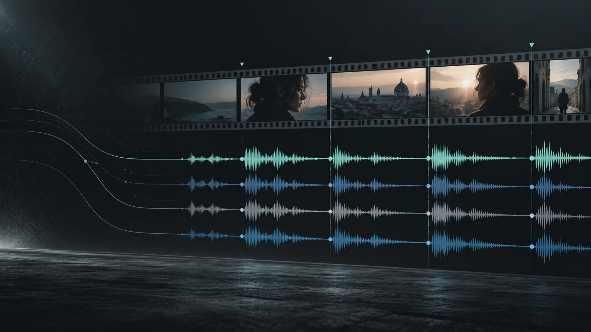
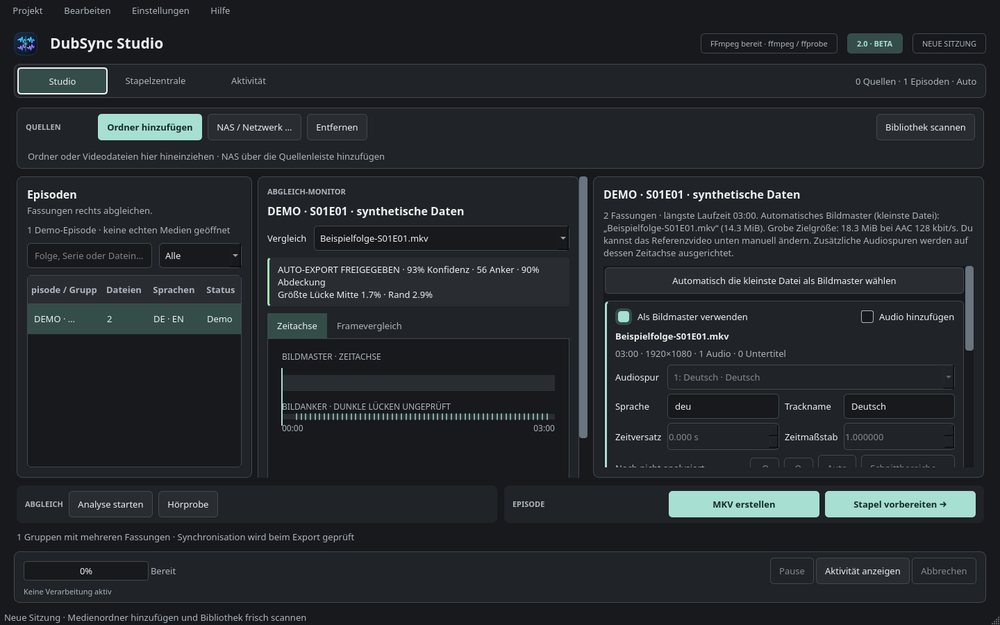
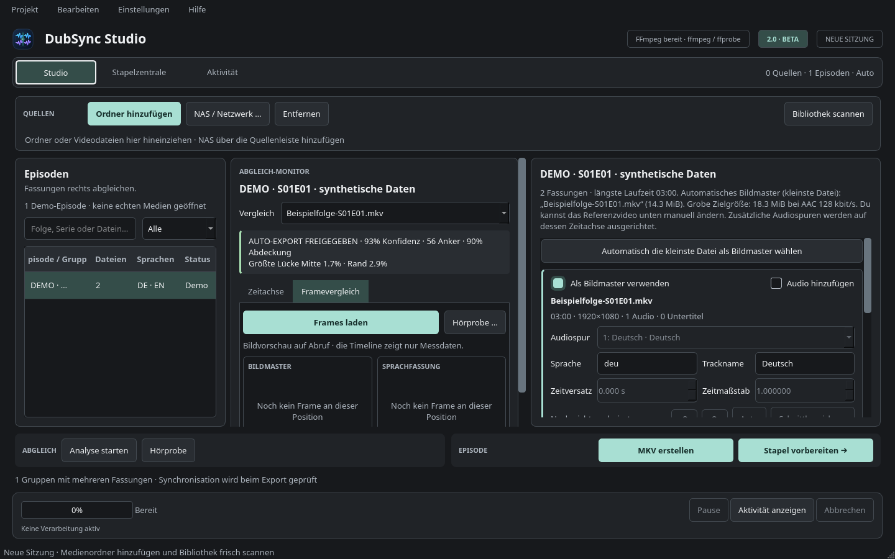
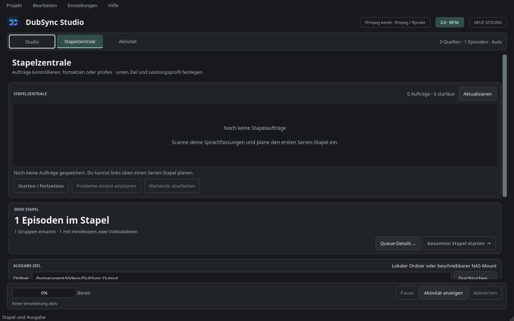
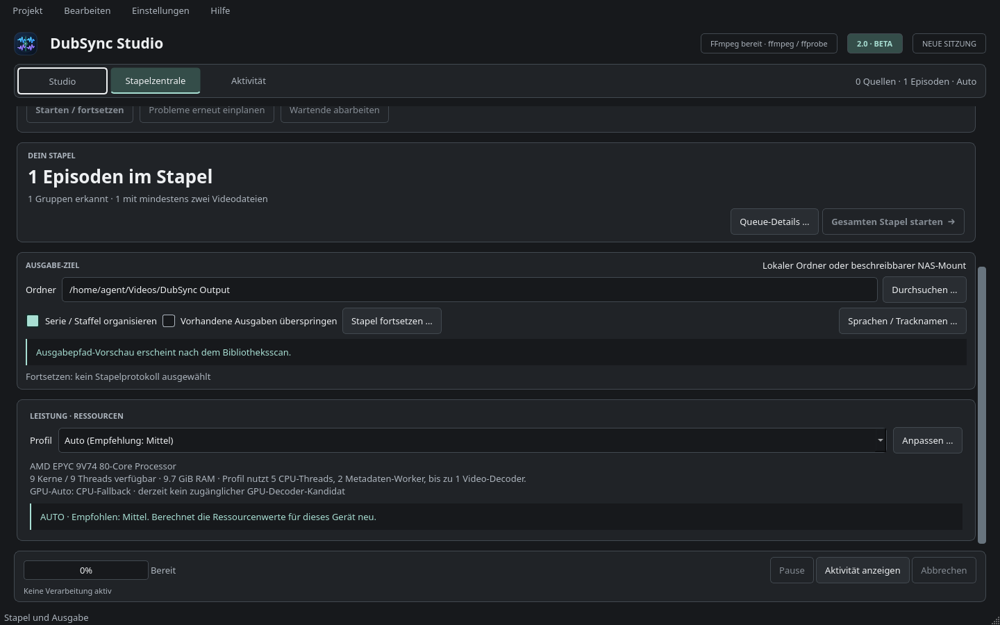
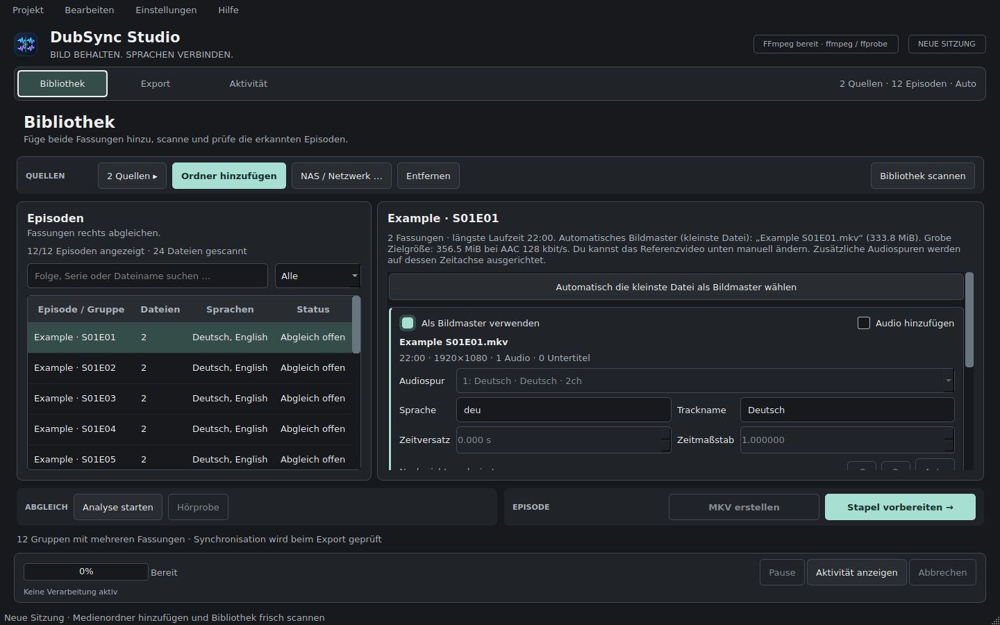

# DubSync Studio 2.0.0b2

Lokale Desktop-Anwendung, die Sprachfassungen derselben Episode anhand ihrer
**Videobilder** synchronisiert und zusätzliche Tonspuren in eine MKV-Datei
übernimmt. Entwickelt für Serienbibliotheken, unterschiedliche Intros und
große Stapel – mit nachvollziehbaren Sicherheitsprüfungen vor jedem Export.



*Gestaltete Titelillustration, kein Screenshot. Eine interaktive Audio-Waveform
gehört zur [späteren Roadmap](docs/ROADMAP_NEXT.md), nicht zum Funktionsumfang
der aktuellen Beta.*

**Stand:** `2.0.0b2` · **Status:** Beta · **Plattform:** Linux-Desktop (reale
Windows-/GPU-Kompatibilität noch in Prüfung) · **Stack:** Python, PySide6,
FFmpeg/FFprobe, OpenCV und NumPy · **Lizenz:** MIT

**Vibe-coded / KI-unterstützt:** Konzept, Anforderungen, Testfälle und
Qualitätsentscheidungen werden vom Projektinhaber gesteuert; für Implementierung
und Iteration wird KI-Unterstützung genutzt.

> **Wichtig zum Beta-Status:** Der zusammenhängende Studio-Arbeitsplatz mit
> Bildanker-Timeline, Framevergleich auf Abruf und integrierter Stapelzentrale
> ist implementiert. Automatisierte Regressionen und Qt-Offscreen-Ansichten
> wurden geprüft. Reale AMD-/Intel-/NVIDIA-Hardware, NAS-Störungen und
> plattformübergreifende Bedienung sind noch **keine** bestätigten Freigaben
> für eine stabile 2.0.0. Siehe [Release-Checkliste](docs/RELEASE_CHECKLIST.md).

## Was DubSync kann

- **Sprachfassungen anhand des Bildmaterials zuordnen:** Bildanker statt
  sprachabhängiger Audioähnlichkeit; Warnungen bei falschen oder unterschiedlich
  geschnittenen Episoden.
- **Synchronisation sichtbar prüfen:** gemessene Anker, Abdeckungsgrad,
  unsichere Bereiche und Framevergleich auf ausdrücklichen Abruf.
- **Mehrsprachige MKVs erzeugen:** vorhandene Videospur bleibt unangetastet;
  Audiospuren und Spracheinstellungen werden vor dem Muxen geprüft.
- **Staffeln im Stapel bearbeiten:** dauerhafte SQLite-Warteschlange,
  Diagnoseberichte sowie ausdrückliches Fortsetzen und erneutes Einplanen.
- **Hardware bewusst nutzen:** Leicht/Mittel/Stark und Auto,
  Intel-/AMD-iGPU- und dGPU-Decoderkandidaten, codecbezogene Messungen und
  geprüfter CPU-Fallback. GPU-Beschleunigung betrifft das Decoding, nicht
  automatisch den Bildvergleich.
- **Sicher mit NAS arbeiten:** erkennungsbasierte Schonung von Netzwerkpfaden,
  kein automatischer Neustart von Jobs, kein stilles Überschreiben. Echte
  Verbindungsabbrüche müssen für den Stable-Release noch geprüft werden.

## Einblicke in die 2.0-Oberfläche

Die folgenden **echten Qt-Screenshots** wurden mit **synthetischen Demo-Daten**
aufgenommen. Sie zeigen weder echte Medieninhalte noch erfolgreich geprüfte
Exporte oder GPU-Leistungsmessungen.

| Studio & Bildanker | Framevergleich |
| --- | --- |
|  |  |
| **Persistente Stapelzentrale** | **Hardwareprofile** |
|  |  |

Weitere Ansichten: [Bibliothek](docs/screenshots/studio-library.png) ·
[Export](docs/screenshots/studio-export.png).

## Schnellstart unter Linux

**Voraussetzungen:** Python 3.10+, `ffmpeg` und `ffprobe` im `PATH`,
ein unterstütztes glibc-basiertes Linux. Der Installer benötigt kein `sudo`.

```bash
# Im entpackten oder geklonten Projektordner
./install-wizard.sh  # grafischer Installationsassistent

# Alternativ ohne feste Desktop-Installation
./setup.sh
./run.sh
```

Der Installer richtet die Python-Abhängigkeiten isoliert ein. Systempakete
wie FFmpeg müssen vorher installiert sein; sie werden nicht ohne Zustimmung
nachinstalliert. Details und Distributionen:
[Linux-Installation](docs/INSTALL_LINUX.md). Für eine erste Prüfung ohne GUI:
`./run.sh --doctor`.

**Navigation:** `Alt+1` Studio · `Alt+2` Stapelzentrale · `Alt+3` Aktivität ·
`Strg+F` Episodensuche · `Strg+Umschalt+J` Queue-Details.

**Weiterlesen:** [Architektur](docs/ARCHITECTURE.md) ·
[Sicherheitsmodell](SECURITY.md) · [Roadmap bis 2.0](docs/ROADMAP_2_0.md) ·
[Nächste Releases](docs/ROADMAP_NEXT.md) · [Changelog](CHANGELOG.md).

## DubSync Studio 2.0 – so arbeitest du im neuen Schnittplatz

1. **Studio** (`Alt+1`): Ordner der verschiedenen Sprachfassungen hinzufügen,
   Bibliothek scannen, links eine Episode auswählen. Mit `Strg+F` durchsuchst du
   die Episodenliste. Der Bildmaster ist weiterhin die kleinste geeignete
   Videodatei oder eine bewusst manuell gewählte Referenz.
2. **Abgleich-Monitor** (Mitte): Eine Quellfassung auswählen, `Analyse starten`
   und die **Zeitachse** prüfen. Mintfarbene Linien markieren tatsächlich
   gemessene Bildanker, flächige Bereiche bestätigte Segmente; dunkle Lücken
   sind **keine** automatisch verifizierten Szenen. Klick auf die Timeline
   setzt die Position; `←`/`→` bewegen sie 5 Sekunden, `Bild auf`/`Bild ab`
   30 Sekunden, `+`/`−` zoomen. Der Qualitätsblock zeigt Konfidenz, Anker,
   Abdeckung und unbestätigte Zeitlücken. Ein unsicherer Abgleich bleibt unsicher.
3. **Framevergleich** (zweiter Reiter des Monitors): Für die aktuelle Position
   werden **erst nach „Frames laden“** maximal zwei FFmpeg-Standbilder aus
   Bildmaster und Sprachfassung gelesen. Nicht zuordenbare Szenen zeigen
   ausdrücklich **kein** Quellbild. Ohne Analyse ist der Zeitvergleich
   ausdrücklich *nominell*, nicht synchronisationsbestätigt. Dadurch lösen
   bloßes Öffnen und Wechseln der Folgen keine zusätzlichen NAS-Reads aus.
4. **Spur-/Schnittkorrektur** (rechts): Sprache, Titel, gewählte Audiospur,
   Startversatz und Schnittbereiche bleiben die bestehenden, voll nutzbaren
   Bearbeitungsfunktionen. Manuelle Korrekturen heben die automatische
   Export-Freigabe nicht auf. **Hörprobe** und **MKV erstellen** bleiben
   explizite Benutzeraktionen.
5. **Stapelzentrale** (`Alt+2`): Persistente Aufträge, Fortschritt,
   Fehlermeldungen, Neustart-Fortsetzung und gezieltes Neuplanen siehst du
   direkt in der Hauptansicht. Zielordner, Überspringen-/Fortsetzen-Regeln
   und Hardwareprofil liegen weiter unten auf derselben scrollbaren Seite.
   Es gibt keinen automatischen Start nach einem Neustart. Die alte
   Warteschlangen-Detailansicht (`Strg+Umschalt+J`) bleibt erhalten.
6. **Aktivität** (`Alt+3`): Vollständige Diagnose, Berichte und Jobs ansehen.
   Fortschrittsanzeige, Pause und Abbruch bleiben auf allen Seiten erreichbar.

Die Abgleichansicht verwendet ausschließlich tatsächlich gemessene
Bildanker. Nicht bestätigte Zeitlücken bleiben im Studio sichtbar.

### Hardware und Datenzugriff

AMD-dGPU, Intel- und AMD-iGPU bleiben über die vorhandenen geprüften
FFmpeg-Decoderpfade (beispielsweise VAAPI unter Linux, D3D11VA unter Windows)
ansprechbar. Das beschleunigt bei kompatibler Hardware **Video-Einlesen**,
nicht automatisch den Bild-Matching-Algorithmus. Erreicht ein GPU-Pfad die
Qualitäts- oder Geschwindigkeitsprüfung nicht, wird der CPU-Weg gewählt.
Geräte- und Codec-Unterstützung ist vom konkreten Treiber abhängig.
Der neue Framevergleich benutzt bewusst keine zweite GPU-Autobenchmark-Runde.

Weitere Details stehen in [GUI-Verifikation](docs/GUI_VERIFICATION.md),
[Designentscheidungen 2.0](docs/STUDIO_2_0_DESIGN.md) und
[Sicherheitskonzept](SECURITY.md).

## Neu in 1.6: Stapel-Warteschlange mit sicherem Wiederanlauf

1. In der Exportansicht **„Gesamten Stapel starten“** wählen. Nach der Zuordnungs-
   und gegebenenfalls Überschreibbestätigung können alle Episoden sofort gestartet
   oder nur als Auftrag gespeichert werden.
2. Unter **„Queue-Details …“** (auch **Strg+Umschalt+J**) sind alle Aufträge
   nach einem Neustart wieder sichtbar. **„Ausgewählten starten / fortsetzen“**
   reaktiviert einen unterbrochenen oder fehlgeschlagenen Auftrag. Es geschieht
   **kein automatischer Start beim Öffnen**.
3. **„Alle wartenden abarbeiten“** verarbeitet ausschließlich geplante Aufträge
   nacheinander. Eine Bestätigung zum Überschreiben ist bei gespeicherten
   Neuaufträgen erneut nötig. Abbruch und Fehler beenden die automatische Folge.
4. **„Probleme neu einplanen“** legt aus dem unveränderten Stapelprotokoll einen
   neuen Auftrag mit fehlgeschlagenen/übersprungenen/unbearbeiteten Episoden an;
   Quellzuordnung und Position werden dafür geprüft. Der neue Lauf überschreibt
   niemals bestehende MKVs automatisch.

Während der Verarbeitung wird der Auftrag lokal und dauerhaft in einer privaten
SQLite-Datenbank protokolliert (`$XDG_STATE_HOME/dubsync-studio/batch-queue.sqlite3`,
ansonsten `~/.local/state/dubsync-studio/batch-queue.sqlite3`). Gespeichert werden
Quellpfade, Zuordnungen, Spuroptionen und Ressourcenprofil. Deshalb enthält die
Datei private lokale Verzeichnisnamen (Unix-Berechtigung `0600`, Elternordner
`0700`). Der bisherige Job-Verlauf bleibt davon unabhängig.

Nach einem Abbruch werden nur diejenigen Ausgaben ausgelassen, deren vorheriges
Journal **dieselbe Exportrezeptur, Quellen und fertige MKV** nach den bestehenden
Prüfkriterien belegt. Geänderte oder nicht belegbare Ausgaben bleiben unberührt
und werden zur Prüfung angezeigt, statt still überschrieben zu werden. Frühere
manuell ausgewählte `batch-*.json`-Protokolle funktionieren weiterhin.
Auch nach mehreren nacheinander abgebrochenen Wiederaufnahmen bleibt der frisch
verifizierte Nachweis für frühere fertige Episoden in den Folgejournalen erhalten.

Für neue Stapel begrenzt eine Momentaufnahme der Systemlast und des freien RAM
die angeforderte Decoder-Parallelität bei Bedarf auf einen Worker. Zusätzliche
NAS-/GPU-Schutzregeln werden weiterhin pro Episode angewendet; Intervall,
Bildanker-Grenzen und Sicherheitsprüfung werden dadurch nicht reduziert.
Der gesamte Ressourcenplan bleibt für den Wiederanlauf gleich, damit die
Journal-Rezeptur unverändert bleibt.

**Prüfstatus:** Simulierter Prozess-Neustart mit zwei Episoden und vorhandenem
Journal ist automatisiert abgedeckt; reale NAS-Ausfälle, Stromverlust und
Plattform-GPU-Messungen benötigen weitere Geräteprüfungen. Die 1.6 ist daher
eine **Beta**, kein voll verifizierter stabiler Release.

## Neu: sichere Stapel-Fortsetzung, GPU-Favorit und Segment-Undo

- **Stapel fortsetzen:** In der Serienansicht „Stapel fortsetzen …“ auswählen
  und eine zuvor erzeugte `batch-*.json` im Protokollordner öffnen. DubSync
  erkennt abgeschlossene Ausgaben nur dann als verifiziert, wenn die früheren
  Quelleinstellungen, alle aktuellen Quelldateien und die aktuelle MKV-Signatur
  übereinstimmen **und** die MKV heute noch Video und Audio enthält. Andere
  Dateien unterliegen den bisherigen Überspringen-/Überschreiben-Regeln;
  ein unpassendes Protokoll führt zu einer sichtbaren Fehlermeldung.
- **Schnellerer GPU-Automodus:** Bei mehreren AMD-, Intel- oder NVIDIA-Adaptern
  speichert die laufende Sitzung für einen Codec kurzzeitig den schnellsten
  zuvor geprüften Decoder. Die nächste Datei wird trotzdem frisch gegen CPU
  validiert. Sechs Folgemessungen später werden alle Adapter erneut verglichen.
  Auf NAS-Medien bleiben zusätzliche GPU-Benchmarks deaktiviert.
- **Besserer Schnittbereich-Editor:** Ausgewählter Abschnitt ist in beiden
  Zeitachsen umrandet, Dauer und Startversatz stehen direkt darunter. Undo/Redo
  funktioniert auch für Zeitwerte; beim Abbrechen fragt DubSync, ob ungespeicherte
  Änderungen verworfen werden sollen. Manuelle Grenzen sind keine unabhängige
  visuelle Freigabe für den automatischen Export.

**Hinweis zur Prüfung:** Wiederaufnahme-Signaturen lesen fünf verteilte
Dateifenster; sie sind keine vollständige kryptografische Medienprüfung.
Wer sicher ausschließen will, dass ein zwischen den Prüffenstern veränderter
Inhalt übersehen wird, muss die betreffende Episode neu synchronisieren.

## Neu: schnellerer Bildabgleich bei schwierigen Schnitten

Der alternative Szenenabgleich für Videos mit abweichenden Intros, fehlenden
Szenen oder leichter Zeitdrift arbeitet jetzt mit vektorisierten
Bildfingerprint-Vergleichen. Auch die Suche nach der plausibelsten zeitlichen
Zuordnung wurde optimiert. Unterschiedliche Videoversionen lassen sich damit
bei großen Bildprobenmengen schneller untersuchen, ohne die Grenzwerte für
automatischen Export zu lockern. Der Diagnosebericht unterscheidet jetzt
die Zeit für Bildkandidaten und Zeitmodell-Bewertung.

**Wichtig:** Das beschleunigt diesen bestimmten Analyseabschnitt, nicht die
gesamte Video-Decodierung. Wie stark DubSync insgesamt schneller wird, hängt
weiter von Video, Speicherort und Hardware ab.

## Neu: automatische GPU-Wahl auf Hybrid-Systemen (Entwicklungsvorschau)

DubSync kann jetzt bei längeren **lokalen** Videos mehrere GPU-Decoder
vergleichen: NVIDIA CUDA, AMD-VAAPI und Intel-VAAPI auf Linux bzw. die
verfügbaren CUDA-/D3D11VA-Pfade auf Windows. Bei einem Intel-/AMD-Hybridsystem
wird die iGPU nicht mehr automatisch zugunsten der ersten AMD-Rendernode
übergangen. Bis zu vier lokal zugängliche Kandidaten treten nacheinander gegen
**einen gemeinsamen FFmpeg-CPU-Referenzlauf** an. Nur ein nachweisbar schnellerer
Pfad mit ausreichend ähnlichen Bildfingerprints wird übernommen; andernfalls
bleibt das bisherige OpenCV-Decoding aktiv. Das entschärft auch unnötig
wiederholte CPU-Benchmarkläufe auf Multi-GPU-Rechnern.

Es handelt sich um einen **Decoder-Vergleich**, nicht um GPU-Beschleunigung des
Bild-Matchers. Die tatsächliche Hardware-Ausführung kann FFmpeg trotz
angefordertem Backend nicht in jedem Fall garantieren. Auf erkannten NAS-Pfaden
überspringt der Automatikmodus den mehrmaligen GPU-Vergleich bewusst, um das
Netzwerk nicht unnötig zu lesen. Gezielte AMD-/Intel-/CPU-Auswahl bleibt in den
Leistungseinstellungen möglich.

```bash
# Beim nächsten lokalen Test alle erkannten Decoder vergleichen (nur lesend):
python -m dubsync --benchmark-decode "/pfad/zur/Folge.mkv" --benchmark-gpu all --json
```

**Validierungsgrenze:** Hybrid-GPUs und Fehlerpfade wurden mit simulierten
Geräteinformationen geprüft; ein echter GPU-/NAS-Leistungsvergleich ist auf dem
Zielsystem nachzuholen. Die bestehenden Regeln für Episodenidentität und
automatische Exportfreigabe bleiben unverändert.

## Neu: integrierte GPUs, lokale Decoder-Parallelität und Laufzeitprofil (Entwicklungsvorschau)

- **Intel-iGPU unter Linux:** Neben AMD-VAAPI gibt es bei erkennbarem Intel-DRM-Rendergerät
  die gezielte Option **Intel-Grafik · integrierte GPU via VAAPI**. Damit kann auf
  einem hybriden Intel-/AMD-Rechner ausdrücklich die integrierte Intel-GPU gewählt
  werden. Eine integrierte AMD-GPU wird über den bestehenden AMD-VAAPI-Modus
  angesprochen. Der FFmpeg-Treiber und der Codec müssen Hardware-Decoding erlauben;
  bei Fehlern bleibt der CPU-Fallback erhalten. Unter Windows bleibt D3D11VA für
  integrierte und dedizierte GPUs verfügbar, ohne herstellerspezifische Gerätewahl.
- **Lokale Videoquellen parallel lesen:** Das starke Analyseprofil kann auf
  Geräten mit ausreichend CPU und RAM zwei Videos derselben Folge gleichzeitig
  vorbereiten. Unter **Leistung → Feineinstellungen → Video-Einlesen** sind ein
  oder zwei Decoder wählbar. Bei erkannten NAS-/Netzwerkpfaden, knappem CPU-/RAM-
  Budget oder einem laufenden GPU-Autobenchmark wird vorsorglich seriell gelesen.
  Der Bildabgleich selbst bleibt pro Folge einmalig und überprüft **alle bisherigen
  Sicherheitsbedingungen** neu.
- **Laufzeitprofil statt geschätzter Geschwindigkeitsversprechen:** Jeder
  Bildabgleich protokolliert Laufzeiten für Metadaten, Videodecoding und
  Bildabgleich sowie die effektive Decoderzahl. Diese Werte erscheinen im
  Diagnosebericht, auch für nicht freigegebene Analysen. Für einen Vergleich
  mit echten Mediendateien (liest die Videos, erzeugt keinen Export):

  ```bash
  python -m dubsync --profile-alignment "/pfad/quelle.mkv" "/pfad/master.mkv" --profile-workers 1 --profile-decoder ffmpeg
  python -m dubsync --profile-alignment "/pfad/quelle.mkv" "/pfad/master.mkv" --profile-workers 2 --profile-decoder ffmpeg
  python -m dubsync --benchmark-decode "/pfad/quelle.mkv" --benchmark-gpu intel-vaapi --json
  ```

  `--profile-alignment ... --json` liefert zusätzlich die maschinenlesbare
  Pipeline-Messung. Für belastbare Vergleiche denselben Dateisatz mit denselben
  Optionen und ohne Hintergrundlast messen; der Profil-Befehl deaktiviert den
  Fingerprint-Cache bewusst. Bei GPUs gilt weiterhin: *Decoder-Anforderung
  ist kein Beweis der Hardware-Ausführung*, und GPU-Transferkosten können
  softwarebasiertes Decoding schneller machen.

  **Testgrenze:** Synthetische lokale Medien und simulierte SMB/NFS-Pfade sind
  geprüft. Das aktuell nicht erreichbare NAS wurde nicht kontaktiert; echte
  Intel-/AMD-iGPUs müssen auf dem Zielrechner gegen die dortigen Treiber/Codecs
  gemessen werden.

## Neu: Radeon-Decoding und geprüfter Video-Fingerprint-Cache (Entwicklungsvorschau)

- **AMD Radeon unter Linux:** Im Leistungsdialog gibt es bei erkanntem und
  zugänglichem AMD-DRM-Rendergerät den Modus **„AMD Radeon · VAAPI-Rendergerät“**.
  Er adressiert gezielt die AMD-GPU, auch wenn zusätzlich eine Intel-GPU vorhanden
  ist. Der allgemeine VAAPI-Modus bleibt für Intel und AMD verfügbar. Unter
  Windows kann auch eine AMD-GPU den systemweiten **D3D11VA**-Decoder nutzen.
  Ob die konkrete Videodatei den GPU-Decoder tatsächlich verwendet, hängt von
  Treiber/Codec/FFmpeg ab; ein Decoderwunsch allein beweist das noch nicht.
- **Wiederholte Videoanalysen werden schneller:** DubSync speichert die bereits
  decodierten kleinen Bildfingerprints pro Datei. Bei jedem Abruf werden Größe,
  Zeitstempel und **11 über die Datei verteilte Inhaltsbereiche frisch gelesen**.
  Ändert sich eine Datei, wird neu decodiert. Ein Quellwechsel oder anderes
  Samplingprofil erzeugt ebenfalls einen getrennten Eintrag.
- **Keine veralteten Episodenentscheidungen:** Der Cache enthält nur pHashes und
  Zeitpositionen, *keine* Ankerzuordnung, keine fertigen Alignment-Ergebnisse und
  keine Exportfreigabe. Jede Analyse berechnet die Zuordnung und sämtliche
  Sicherheitsgrenzen erneut; der alte Ergebnis-Cache bleibt deaktiviert.
  Im Leistungsdialog kann „Bildfingerprints wiederverwenden“ abgeschaltet werden.
  Der Cache ist im Benutzerverzeichnis auf **400 Einträge / maximal 128 MiB**
  begrenzt und kann jederzeit gelöscht werden, ohne Medien zu ändern.

  Beispiel für AMD-spezifisches Decoding-Benchmarking:

  ```bash
  python -m dubsync --benchmark-decode "/pfad/zur/Folge.mkv" --benchmark-gpu amd-vaapi --benchmark-seconds 12
  ```

  **Grenzen:** Die Änderungserkennung nutzt einen verteilten Datei-Fingerprint,
  keinen vollständigen Hash sämtlicher Medienbytes. Bei absichtlich unter
  unveränderten Dateimetadaten manipulierten Dateien ist ein Cache-Treffer nicht
  kryptografisch ausgeschlossen. Für besonders sensible Medien lässt sich der
  Fingerprint-Cache im Leistungsdialog deaktivieren. Echte AMD-GPU-Hardware war
  in der Testumgebung nicht vorhanden; Tests prüfen Geräteauswahl, Fallback und
  die unveränderte Zuordnungssicherheit, aber noch nicht die GPU-Ausführung.

## Neu: Hardwarebewusstes Video-Decoding (Entwicklungsvorschau)

- **CUDA/NVDEC unter NVIDIA**, **VA-API unter Intel/AMD** und **D3D11 unter Windows**
  können für die Frame-Extraktion über FFmpeg angefordert werden. Die tatsächliche
  Nutzbarkeit hängt vom Decoder, Treiber und Videocodec ab; Fehler fallen ohne
  Export-Freigabeänderung auf den bewährten OpenCV-Pfad zurück.
- **Auto** lässt OpenCV standardmäßig aktiv. Für längere Videos mit plausibel
  verfügbarer GPU werden CPU und GPU auf einem kurzen Ausschnitt gemessen.
  Der GPU-Pfad wird nur bei messbarem Vorteil und hinreichend ähnlichen
  Bildfingerprints übernommen. Das verhindert unnötige GPU-Startkosten und
  stellt sicher, dass „GPU“ nicht pauschal als schneller dargestellt wird.
- **FFmpeg CPU-Sampling** ist als explizit auswählbare Alternative verfügbar:
  Es verkleinert die Frames vor der Übergabe an Python auf 32×32 Pixel. Ob das
  schneller als OpenCV ist, hängt von Codec und Hardware ab.
- Eine reproduzierbare Messung für deine eigenen Videos:

  ```bash
  python -m dubsync --benchmark-decode "/pfad/zur/Folge.mkv" --benchmark-seconds 12
  ```

  Mit `--json` erhältst du Messdaten für Diagnose und Vergleich. Es wird **nur
  gelesen**, keine Mediendatei geändert. Die Ausgabe misst FFmpeg-CPU gegen
  die lokal plausible FFmpeg-GPU, nicht die gesamte Synchronisationspipeline.
  Der pHash-Abgleich und die Qualitäts-/Sicherheitsgrenzen bleiben CPU-basiert.

  **Stand:** Die neue FFmpeg-Extraktion und die Auswahl-/Fallback-Logik wurden
  mit synthetischen Videodateien getestet. Echte GPU-Hardware war in der
  Entwicklungsumgebung nicht vorhanden; die GPU-Ausführung selbst ist
  **noch nicht auf NVIDIA/AMD/Intel verifiziert**.

> **Entwicklungsvorschau – Segment-Editor:** Der Dialog besitzt inzwischen gezielte
> Qt-Regressionstests (Teilen, Deaktivieren, Überlappungen und Sicherheitsstatus).
> Reale Schnittfassungen und das Zusammenspiel mit deinem Linux-Desktop/NAS sind
> weiterhin nicht vollständig verifiziert. Bitte erste Exporte kontrollieren.

### Neu: Schnittbereiche manuell bearbeiten

Nach **Bibliothek → Episode → Synchronisation analysieren** kannst du bei einer
zusätzlichen Audiospur **„Schnittbereiche …“** öffnen. Der Editor zeigt zwei
Zeitachsen und eine Tabelle mit Quellstart/-ende und Masterstart/-ende in Sekunden.
Du kannst Grenzen direkt eingeben, einen Abschnitt in zwei Teile aufteilen,
Abschnitte entfernen oder über **Aktiv** stummschalten. Nicht zugeordnete
Master-Bereiche bleiben in der zusätzlichen Audiospur stumm. **Abbrechen**
verwirft alle Änderungen im Dialog; **Änderungen verwerfen** stellt die beim
Öffnen vorhandene Zuordnung wieder her.

Die Eingabe wird auf zeitliche Reihenfolge, Überlappungen, Dateigrenzen,
Mindestlänge und zulässigen Zeitmaßstab geprüft. Diese Prüfung bestätigt
**nicht** die Bildübereinstimmung. Jede manuelle Änderung erfordert deshalb
beim **Einzelexport** eine ausdrückliche Warnungsbestätigung. Mit der
**„Auto“**-Schaltfläche neben der Spur kannst du die automatische Zuordnung
wiederherstellen. Der automatische Serienstapel überspringt Episoden mit
manuell editierten Schnittbereichen und nennt den Grund im Stapelbericht.

Manuelle Schnittbereiche bleiben beim Wechsel zwischen Episoden in der Sitzung
erhalten. Beim **expliziten Speichern eines `.dubsync`-Projekts** werden sie
ebenfalls gespeichert und nach erneuter Analyse nur dann übernommen, wenn
Größe und Änderungszeit beider Quelldateien unverändert sind. Die Bearbeitungen
werden nie als automatisch geprüft ausgegeben. Manuelle Zeitversatz- oder
Skalenänderungen ersetzen wie bisher eine Segmentzuordnung durch den linearen
Modus; bei ausreichenden neu berechneten Bildankern kann die bestehende
lineare Sicherheitsprüfung weiterhin eine automatische Freigabe erlauben.



*Historischer Screenshot des 1.5-Editors; die neue 2.0-Oberfläche ist am Anfang
dieser README abgebildet.*

## Zusätzliches Sicherheits- und Performance-Update

- **Experimentelle, konservative Schnittkorrektur:** DubSync kann mehrere klar bestätigte Szenenbereiche getrennt synchronisieren, beispielsweise wenn mitten in der Folge ein Abschnitt eingefügt oder entfernt wurde. Der neue Ton bleibt an unbelegten Masterstellen stumm, statt Dialog aus der falschen Szene zu verwenden. Normale lineare Abgleiche bleiben unverändert.
- Der automatische Export benötigt jetzt bestätigte Bildanker über die **gemeinsame** Laufzeit: höchstens 20 % ungeprüfter Abschnitt im Mittelteil und höchstens 15 % ungeprüfter Abschnitt am Anfang oder Ende. Ein zusätzliches Intro, das außerhalb der gemeinsamen Timeline liegt, zählt nicht als Fehler.
- Bei zu großen Lücken erklärt die Diagnose, warum ein Bildabgleich trotz guter globaler Trefferquote nicht für einen automatischen Export genügt. Die Audiospur wird dann nicht ohne ausdrückliche Freigabe exportiert.
- Vor dem Übernehmen einer fertigen MKV kontrolliert DubSync die übernommenen Video-, Audio-, Untertitel- und Anhangsströme sowie die Laufzeit und den Codec neu hinzugefügter Audiospuren. Schlägt die Prüfung fehl, wird die temporäre Ausgabe verworfen; Originale bleiben unangetastet.
- Der CPU-Bildsequenzabgleich verwendet eine vektorisierte NumPy-Berechnung. Im isolierten 700×700-Sample-Test war er etwa zwölfmal schneller; die gesamte Analyse kann weiterhin vom Video-Decoding oder einem NAS-Laufwerk begrenzt werden.

## Neu in 1.5.15 – Studio-Oberfläche

- Graphitgraue Qt-Oberfläche mit zurückhaltendem Mint-Akzent, klaren Fokus- und deaktivierten Zuständen.
- Kompakte Reiter **Bibliothek / Export / Aktivität**, per Tastatur auch mit Alt+1 / Alt+2 / Alt+3.
- Quellen über die gesamte Fensterbreite; nach dem Scan einklappbar und über „Quellen“ wieder erreichbar.
- Mehr Platz für die Episodenliste und den separat scrollbareren Spur-Editor. Die Spaltenteilung ist verstellbar.
- Eigene Leer- und Keine-Treffer-Zustände; das Löschen einer Suche stellt die Liste sofort wieder her.
- Exportoptionen bleiben in kleinen Fenstern scrollbar. Hoher Kontrast weiterhin über Einstellungen.
- Noch nicht analysierte Gruppen heißen **Abgleich offen**. Mehrere Fassungen allein bedeuten keine sichere Synchronisation.
- Diagnoseaktionen sind in Aktivität gebündelt; Fortschritt, Pause und Abbruch bleiben dauerhaft sichtbar.
- Die Live-Ansicht hält maximal 3000 Logzeilen; vollständige Protokolle bleiben über die bestehenden Berichte erreichbar.

Der ursprüngliche GUI-Umbau aus 1.5.15 änderte die Medienalgorithmen nicht; die oben genannten Verbesserungen sind in diesem aktualisierten Paket zusätzlich enthalten.
Die GUI nutzt weiterhin PySide6/Qt, ohne Browser-Engine oder zusätzliche Laufzeitabhängigkeiten.

**Update:** ZIP entpacken, im entpackten `DubSyncStudio`-Ordner `bash install.sh` ausführen.
Der bestehende Installationspfad und die virtuelle Umgebung werden vom Installer berücksichtigt;
Details und alternative Zielpfade stehen in [INSTALL_LINUX.md](docs/INSTALL_LINUX.md).

## Neu in 1.5.14 – komplett überarbeitete Bedienung und Hardwareprofile

Die Anwendung hat jetzt eine **dreiteilige Arbeitsoberfläche** statt der bisherigen
überladenen Alles-auf-einem-Bildschirm-Leiste:

1. **Bibliothek**: Ordner/NAS-Freigaben hinzufügen, scannen, Episoden auswählen,
   Audiotracks und Bildmaster prüfen; bei Bedarf eine einzelne Folge analysieren,
   vorhören oder exportieren. Danach „Weiter: Stapel & Export“ wählen.
2. **Export**: Ausgabeordner und Organisationsoptionen einstellen, Leistungsprofil
   wählen und über „Gesamten Stapel starten“ ausführen. Eine Zusammenfassung zeigt
   die Zahl der erkannten Gruppen, Gruppen mit mehreren Dateien und die aktiven
   CPU-/Sample-Budgets.
3. **Aktivität**: Live-Ausgaben und alle Diagnosen an einem Ort, insbesondere das
   **Stapel-Gesamtprotokoll** mit dem Status und sämtlichen Versuchen *jeder* Folge.

Der Job-Fortschritt mit Pause/Stopp bleibt unten auf allen Seiten sichtbar. Beim
Stapelstart wechselt die App automatisch in die Aktivitätsansicht. Der bewährte
Scan-, Export-, Inhalts- und Sicherheitsalgorithmus aus 1.5.13 wurde nicht geändert.

### Leistungsprofile

Über **Export → Leistung** wählst du:

| Profil | CPU / Metadaten | Frames / Analyse | Zweck |
| --- | --- | --- | --- |
| **Leicht** | ca. 25 % verfügbarer CPU-Threads, ein Metadaten-Worker, ein Video-Decoder | gleiche Analyseparameter | Niedrige Last, Multitasking oder Akkubetrieb |
| **Mittel** | ca. 50 % der Threads, bis zu vier Metadaten-Worker | gleiche Analyseparameter | Alltag, Hintergrundverarbeitung |
| **Stark** | fast alle CPU-Threads (ab vier Threads bleibt einer frei), bis zu acht Metadaten-Worker und zwei lokale Decoder | gleiche Analyseparameter | Größtmögliche sinnvolle Auslastung |
| **Auto (Empfehlung)** | wählt anhand CPU-Threads, physischen Kernen und RAM eines der drei Presets | gleiche Analyseparameter | Für die meisten Systeme empfohlen |

Ressourcenwerte werden auf jedem Gerät anhand CPU-Affinität, Cgroup-Limits und RAM
**bei jedem Start und beim Profilwechsel neu berechnet**; gespeicherte Presets
sind keine eingefrorenen Threadzahlen. Vor einem Warteschlangenauftrag reduzieren
aktuelle Systemlast und verfügbarer Arbeitsspeicher bei Bedarf die Decoder-Parallelität.
SMB-/NFS-Quellen werden für die Metadatenabfragen zusätzlich auf höchstens zwei
Worker begrenzt; GPU-Autobenchmarks verhindern konkurrierende Decoder-Messungen.
Für alle Presets gelten ab Werk **1200 Bildproben, 0,75 s Frame-Abstand und
128 kbit/s AAC**. Wer im Dialog die Analysegenauigkeit oder Audioqualität
ändert, behält diese Werte auch beim Umschalten zwischen Leicht/Mittel/Stark.

Der Videodecoder erkennt automatisch die **Intel-iGPU (VAAPI unter Linux)**,
AMD-Rendernodes und weitere angebotene GPU-Kandidaten. Auf einem Laptop mit
zugänglicher Intel-iGPU kann diese ohne manuelle Konfiguration vorgeschlagen
werden. Nur ein **pro Video gemessener** GPU-Pfad, der inhaltlich mit dem CPU-Abgleich
übereinstimmt und mindestens 15 % schneller ist, wird verwendet. Inkompatible
Treiber, Rechte oder Codecs führen zum CPU-Fallback, nicht zu einem Abbruch.
Die Frame-Vergleiche
werden auf der CPU ausgeführt, und das Bildvideo wird beim MKV-Export nicht neu
kodiert. Die automatischen Sicherheitsgrenzen bleiben in allen Profilen gleich.
Profile und Ausgabeoptionen werden gemerkt; Episoden, Quellen und fertige
Analysezuordnungen dagegen nicht – jeder Programmstart ist eine neue Sitzung.

## Neu in 1.5.13 – Inhaltsprüfung und sichere Erkennung vertauschter Folgen

Wenn die Aufnahmen zu einer Folge nur im Vorspann oder Abspann zusammenpassen,
kennzeichnet DubSync den Stapel-Eintrag als **INHALTSVERDACHT** statt weitere
Laufzeitgrenzen zu lockern. Häufig steckt dahinter eine falsch nummerierte
Folge in einer der Quellbibliotheken. Sind mindestens zwei unsichere Folgen
innerhalb derselben Serie und Staffel vorhanden, prüft DubSync eine mögliche
**gegenseitige Vertauschung** der Audiospur-Quellen (z. B. E02 ↔ E03).

Eine automatische Korrektur erfolgt **nur**, wenn **beide** gekreuzten
Videoabgleiche sicher sind (die bestehenden Exportbedingungen bleiben erhalten)
**und** zusätzlich starke Bildtreffer aus mehreren Abschnitten des eigentlichen
Episoden-Mittelteils vorliegen. Quelle und Bildmaster bleiben unverändert auf
Datenträgern; DubSync verwendet den zum Bildmaster gehörenden Episodennamen
und übernimmt nur die durch Bildvergleich belegte Audiospur. Die tatsächlich
verwendeten Quelldateien und beide zusätzlichen Bildanalysen sind im
**Stapel-Gesamtprotokoll** dokumentiert.

Diese automatische Rettung ist bewusst eng begrenzt: Sie funktioniert vorerst
für gegenseitige Vertauschungen von **zwei** zuvor als inhaltlich unpassend
erkannten Episodengruppen derselben Serie/Staffel (maximal drei Episoden
auseinander), jeweils mit einem Bildmaster und einer Zusatzquelle. Bereits
exportierte Folgen, manuell festgelegte Bildmaster oder einseitig plausible
Treffer werden nicht ungefragt neu zugeordnet. Sie wird erst ausgelöst, nachdem
beide ursprünglichen Abgleiche scheiterten; der Stapel kann dadurch länger
dauern. Wenn die falsche Datei eine Folge außerhalb der eingelesenen
Bibliothek enthält, fehlt weiterhin die passende Quelle und es gibt keinen
sicheren automatischen Export.

E02/E03-Fall: Das Diagnoseprotokoll von 1.5.12 zeigte praktisch ausschließlich
Bildanker am Anfang und Ende. Die App erkennt diese Konstellation jetzt und
probiert eine echte inhaltliche Vertauschung, statt nur die Samplezahl weiter
zu erhöhen. Ob die konkreten Dateien vertauscht sind, kann nur eine neue
Analyse mit den Medien bestätigen.

## Seit 1.5.12 – vollständiges Stapel-Gesamtprotokoll

Bei **Bibliotheken scannen → Serien-Stapel** wird ab dem Start ein separates
JSON-Gesamtprotokoll für den **gesamten Lauf** gespeichert. Alle Episoden sind
von Anfang an aufgeführt, einschließlich jener, die später noch nicht gestartet
wurden. Jede Folge hat einen eigenen Status (exportiert, übersprungen,
fehlgeschlagen, abgebrochen, noch nicht gestartet), eine Begründung, eine Liste
der Quelldateien und **jeden Bildabgleichversuch**. Auch die komplette
Bildabgleich-Diagnose (Sampling, Bildanker, Long-Offset-Suche, Sicherheitswerte,
Abbruchgründe) des ersten und des wiederholten Versuchs wird in den
**Gesamtbericht eingebettet**. Der Bericht wird während der Ausführung
fortgeschrieben, sodass E02 erhalten bleibt, auch wenn die Analyse bei E03
abgebrochen wird. Ein Neustart ohne alte Sitzungsdaten löscht die Berichte nicht.

- In der Oberfläche: **Stapelprotokoll** oder **Einstellungen → Stapel-Gesamtprotokolle…**
  (`Strg+Umschalt+D`). Dort können alle Folgen einzeln angesehen, der
  **gesamte Bericht kopiert** oder als JSON gespeichert werden.
- Im Terminal: `dubsync-studio --latest-batch --json` für den **vollständigen**
  letzten Lauf, `dubsync-studio --latest-batch` für alle Episoden im Klartext,
  `dubsync-studio --list-batches` für vorherige Stapelläufe.
- Dateien: `~/.local/state/dubsync-studio/logs/batches/batch-*.json`
  (bei `XDG_STATE_HOME` entsprechend dort). Sie bleiben getrennt von den
  einzelnen `alignment-*.json`-Berichten.

**Hinweis:** Ein Stapelprotokoll protokolliert jeden Bearbeitungsstatus; es
lockert **nicht** die Sicherheitsgrenzen und erzwingt keine ungeprüften Exporte.
Die JSON-Dateien enthalten Dateinamen und technische Metadaten. Vor dem
Weitergeben auf vertrauliche Dateinamen prüfen.


**Seit 1.5.11:** Bei ungewöhnlich unterschiedlichen Laufzeiten erhält ein unsicherer
Stapel-Bildabgleich automatisch genau einen zusätzlichen Versuch mit höherer
Bildprobendichte (maximal 3600 Samples). Die unveränderten Sicherheitsregeln
verhindern den Export nicht validierter Synchronisationen. Gründe für
übersprungene Episoden erscheinen sofort im laufenden Protokoll und vollständig
in der Endauswertung. Eine bereits vorhandene Zieldatei ist ein eigenständiger
Skip-Grund; die Checkbox »Vorhandene Ausgaben überspringen« steuert das.


> **Weiterhin enthalten:** Besserer Bildabgleich für große Zeitversätze bei weiterhin frischem Start. Jeder Start beginnt mit einer leeren Bibliothek und frischen Analysen. Alte Quellen, Zuordnungen, Zeitkorrekturen und Projektverweise werden nicht automatisch geladen. Dauerhafte Programmeinstellungen bleiben erhalten; ausdrücklich geöffnete Projektdateien weiterhin nutzbar.

**DubSync Studio** ist eine lokale Desktop-Anwendung, um getrennte Fassungen
derselben Episode zu analysieren und zusätzliche Audiospuren in eine MKV-Datei
einzubetten. Die folgenden Abschnitte dokumentieren auch ältere Releases.

## Installation als Desktop-App auf verschiedenen Linux-Distributionen

Für eine dauerhafte benutzerlokale Installation mit Anwendungsmenüeintrag bietet DubSync Studio einen grafischen Assistenten im klassischen Windows-Installer-Stil:

```bash
chmod +x install-wizard.sh install.sh setup.sh run.sh uninstall.sh install-desktop.sh
./install-wizard.sh
```

Der Assistent führt durch Willkommen, Zielordner, Installationsoptionen, Systemprüfung, Fortschritt und Abschluss. Er verwendet Tkinter aus der Python-Standardbibliothek, sodass PySide6 für den Installer selbst noch nicht installiert sein muss. Der Anwendungsmenüeintrag wird automatisch erzeugt; eine zusätzliche Desktop-Verknüpfung lässt sich im Assistenten aktivieren.

Wer lieber das Terminal nutzt, kann weiterhin `./install.sh` ausführen. Ein benutzerdefinierter Installationsort ist beispielsweise mit `./install.sh --install-dir "/home/ich/Applications/DubSync Studio"` möglich. Bei Updates bleibt die `.venv` erhalten. Der Installer verweigert fremde, nicht leere Zielordner, statt sie zu leeren, und registriert den verwalteten Installationspfad für spätere Updates und Deinstallation.

Unterstützt werden gängige glibc-basierte Distributionen mit Python 3.10+ und passenden PyPI-Wheels, insbesondere Debian/Ubuntu/Linux Mint/Pop!_OS, Fedora, Arch/Manjaro und openSUSE. Alpine/musl und ungewöhnliche CPU-Architekturen benötigen ggf. eine angepasste Abhängigkeitsinstallation. Fehlende Systempakete werden nur gemeldet; der Installer installiert sie nicht automatisch und benötigt kein `sudo`.

Wenn der Menüeintrag auf KDE/SteamOS als ungültig angezeigt wird, führe `./repair-desktop-entry.sh` im entpackten Quellordner aus, um den vorhandenen Menüeintrag und eine bestehende Desktop-Verknüpfung sicher neu zu erzeugen. Diagnose nach der Installation: `~/.local/bin/dubsync-studio --doctor`. Die Standard-Deinstallation über `~/.local/share/dubsync-studio/app/uninstall.sh` erhält Einstellungen, Cache und Jobhistorie; `--purge-data` löscht diese bewusst ebenfalls. Ausführliche Installations- und Paketmanagerhinweise: [docs/INSTALL_LINUX.md](docs/INSTALL_LINUX.md).

Für portable Nutzung ohne Desktop-Installation bleiben `./setup.sh` und `./run.sh` verfügbar.


## Seit 1.5.10 – zusätzliche Intros über zwei Minuten

Eine Laufzeitabweichung über 120 Sekunden ist **kein pauschaler Fehler**. Der erste schnelle Gleichzeitvergleich scheidet bei deutlich verschiedenen Laufzeiten aus. DubSync sucht jetzt bei Abweichungen ab 30 Sekunden zusätzlich nach großen Zeitverschiebungen anhand seltener Bildmuster und prüft anschließend, ob die Übereinstimmung über einen ausreichend großen Abschnitt der **richtigen** Episode trägt. Die bisherigen Sicherheitsregeln gelten weiterhin; lokal unterschiedliche Schnittfassungen können weiterhin eine manuelle Prüfung erfordern, weil der Export nur einen einzigen linearen Audio-Zeitverlauf abbilden kann.

**Diagnose:** In der JSON-Ausgabe steht `stages.long_offset` mit den gefundenen Verschiebungen, der Zahl bestätigter Bildanker und der Sicherheitsbewertung. Wenn ein Bericht `cancelled` meldet, wurde der Lauf unterbrochen und kann nichts über die Synchronisationsqualität sagen. Ein bestätigter Druck auf „Stapel stoppen“ bleibt ein Abbruch, nicht eine Laufzeitgrenze.

## Neuer Sitzungsstart seit 1.5.9

DubSync Studio zeigt beim Öffnen **keine Quellen, keine alten Episodengruppen und keine früheren Zeitkorrekturen** mehr an. Auch wenn 1.5.8 vorher Quellen gespeichert hat, werden diese beim ersten Start mit 1.5.14 **nicht wieder geladen** und aus `settings.json` entfernt. Frühere Alignment-Ergebnisse werden nicht aus dem persistenten Cache bezogen; für jeden Prozess wird eine neue temporäre Cache-Datenbank angelegt. Der Batch prüft und analysiert die ausgewählten Videodateien weiterhin neu.

**Ablauf:** (1) DubSync starten – leere Bibliothek, (2) Medien-/NAS-Ordner hinzufügen, (3) „Bibliothek scannen“ drücken, (4) Episoden prüfen und den Stapel starten. Beim nächsten Start beginnt das erneut bei Schritt 1. **Einmal hinzugefügte Ordner müssen nach einem Neustart erneut hinzugefügt werden.**

Gespeichert bleiben nur **Ausgabeordner, Ausgabestruktur, Darstellungsoption „Hoher Kontrast“ und Leistungseinstellungen**. Eine bewusst als `.dubsync` gespeicherte Projektdatei wird **nicht automatisch geöffnet**, kann jedoch jederzeit über „Projekt → Projekt öffnen“ geladen werden. Das öffnet ihre gespeicherten Quellen und Zuordnungen nur auf ausdrückliche Anforderung; nach erneutem Programmstart sind diese wieder weg, sofern du das Projekt nicht noch einmal öffnest. **Exportierte Videos, gespeicherte Projektdateien und Diagnose-/Jobprotokolle werden nicht gelöscht**. Protokolle bleiben zur Fehlerdiagnose verfügbar, beeinflussen die neue Sitzung jedoch nicht.

`settings.json` liegt standardmäßig unter `~/.config/dubsync-studio/settings.json`. Der frühere persistente Alignment-Cache wird nicht mehr geöffnet oder verwendet; ältere Cache-Dateien bleiben als Bestandsdaten unangetastet, während der neue Sitzungs-Cache mit dem Programm endet.

## Neu in 1.5.8 – Stapelverarbeitung und Folgenzuordnung

1. **Bibliotheken scannen**, anschließend **Stapel**. In der Bestätigung werden die erkannten Episoden und dazugehörige Dateinamen angezeigt. Prüfe insbesondere, dass S01E04 mit S01E004 und nicht mit S01E001 kombiniert wird.
2. Während des Laufs zeigt die Oberfläche ausdrücklich `Stapelposition 1/13 · Episode S01E04`. Die erste bearbeitete Episode ist nicht zwangsläufig E01, zum Beispiel wenn davor Dateien übersprungen wurden.
3. Die Schaltfläche **Stapel stoppen…** verlangt jetzt eine gesonderte Bestätigung. Falls du sie nicht bestätigst, läuft der Stapel weiter. Ein bestätigter Stopp erzeugt eine Übersicht über bereits abgeschlossene und noch nicht begonnene Folgen.
4. Der Scan erkennt Episodennummern in `SouthparkS01E04_SSS.mp4` sowie `South Park S01E004.mkv` als Folge 4. Eine explizite Kennung `S01E001` in einer E04-Gruppe blockiert den automatischen Export dieser Gruppe. **Achtung:** Sind Videos inhaltlich falsch als E04 *benannt*, lässt sich die echte Episodennummer nicht allein aus dem Dateinamen bestimmen. Der Bildabgleich entscheidet weiterhin, ob die Audiospuren sicher zusammenpassen.
5. Startest du den Stapel direkt nach dem Scan, endet das optionale Metadaten-Vorwärmen, damit dein NAS möglichst nicht von zwei Hintergrundaktionen gleichzeitig beansprucht wird.

### Diagnose eines abgebrochenen Laufs

- Der Bericht `ABGEBROCHEN – KEINE BEWERTUNG` zeigt ausdrücklich, dass der Bildvergleich *nicht* vollständig ausgewertet wurde. Ein Abbruch ist kein Beleg für eine fehlerhafte oder unsichere Synchronisation.
- 1.5.8 führt den Diagnoseauslöser `user_button_confirmed` für bewusst bestätigte Stapelabbrüche ein; vorhandene ältere Berichte mit `user_button` bleiben lesbar.
- Der Diagnosebericht nennt nun auch die Stapelposition und die tatsächliche Episodennummer getrennt. Die gesammelten Bilder, Audios und vollständigen Dateipfade werden nicht im JSON gespeichert. Frame-Zähler, Decoder-Zeitstempel und der Abbruchauslöser werden dagegen festgehalten.
- **Stapelprotokoll** lässt sich über den Knopf **Protokoll** einsehen. Dort stehen die Zuordnung jeder Episode und die Gründe für ausgelassene Folgen.

## Funktionen aus 1.5.6 – Diagnose und Abgleichkorrekturen

- **Jeder frisch berechnete Abgleich erzeugt eine JSON-Diagnose** – auch wenn zu wenige Bildanker gefunden wurden, die Synchronisation als unsicher gilt oder eine Exception auftrat. Die Berichte enthalten Dateinamen, pseudonyme Datei-IDs, technische Metadaten, Frame- und Decoderstatistik, Zeitstempelprobleme, Kennzahlen beider Vergleichsmethoden, Residuenabschnitte und die einzeln geprüften Sicherheitsbedingungen. Keine Videobilder, Audiodaten, vollständigen Quelldateipfade oder Zugangsdaten werden beabsichtigt exportiert. Exception-Text kann trotzdem technische Umgebungsinformationen enthalten: vor dem Weitergeben prüfen.
- **Fehlgeschlagene Sicherheitsprüfungen zeigen den gemessenen Wert und Grenzwert**, statt nur „unsichere Synchronisation“. Erklärt außerdem, warum die Gleichzeitbild-Prüfung oder der alternative Bildabgleich abgelehnt wurde.
- **Auswahl zwischen letzter und älteren Analysen:** In **Einstellungen → Bildabgleich-Diagnoseberichte…** eine Folge (z. B. `E02`) auswählen, die verständliche Auswertung und das JSON ansehen und mit **JSON für Fehlersuche kopieren** in die Zwischenablage übernehmen. Maximal 40 Berichte werden unter `~/.local/state/dubsync-studio/logs/alignments/` aufbewahrt (bei angepasstem `XDG_STATE_HOME` dort). Alte Berichte werden automatisch gelöscht. Datei- und Verzeichnisrechte sind auf den Benutzer beschränkt.
- **Ohne GUI:** `./run.sh --list-alignments` listet vorhandene Reports, `./run.sh --latest-alignment` zeigt den letzten Bericht kompakt, `./run.sh --latest-alignment --json` zeigt die vollständigen Messdaten. Bei installierter Anwendung die gleichen Argumente an `dubsync-studio` übergeben.
- **Korrigierte Fallback-Auswahl:** Bei unsicherem globalem Sequenzabgleich wird der alternative Bildabgleich unabhängig von der Anzahl der Anker geprüft. Die Ergebnisse werden nach erfolgreicher Sicherheitsprüfung, zeitlicher Konsistenz und Bildqualität verglichen; mehr Bildanker allein reichen nicht zur Auswahl.
- **Wiederholte Standbilder:** Zu wenige unterschiedliche Frame-Hashes gelten nicht mehr als hinreichender Beleg für eine automatische Synchronisation. Auch fehlerhafte/stagnierende Decoder-Zeitstempel und wiederholte Fortschrittsereignisse werden behandelt.
- **Alter Cache:** Synchronisations-Ergebnisse älterer Engines werden wegen des korrigierten Auswahlverfahrens nicht erneut verwendet. Bestehende Projekte und Einstellungen bleiben erhalten. Batch-Exporte bleiben weiterhin auf frischen Ergebnissen.

### South Park E02 diagnostizieren

1. DubSync Studio starten, die zwei Staffelordner wie gewohnt laden. **E02 auswählen** (im zugesendeten Protokoll stand dagegen `E004`), den Bildmaster unverändert automatisch bestimmen lassen und **Einzelanalyse** erneut starten.
2. In **Einstellungen → Bildabgleich-Diagnoseberichte…** den neuesten Eintrag mit `E02` auswählen. Auf `decision.failed_conditions`, `stages.same_timeline`, `stages.sequence_match`, `stages.candidate_comparison` und `stages.affine_fit` achten.
3. **JSON für Fehlersuche kopieren** und den JSON-Text im Chat teilen. Alternativ im Terminal `dubsync-studio --list-alignments` verwenden, anschließend `dubsync-studio --latest-alignment --json`. Vor dem Teilen Dateinamen und Tracebacks auf persönliche Informationen prüfen.

**Wichtig:** Ein neu hinzugefügter Bericht beweist nicht, dass beide Versionen denselben Videoschnitt enthalten. Wenn die visuelle Evidenz weiterhin unzureichend ist, bleibt der automatische Export aus Sicherheitsgründen gesperrt. Ein Cache-Treffer erzeugt keinen neuen Abgleichbericht.

## Frühere Verbesserungen – Stapelläufe und Live-Rückmeldung

- Fortschrittsverlauf als kompakte Kurve sowie sichtbare Pause-/Fortsetzen- und Abbrechen-Steuerung.
- Pausieren greift kooperativ am nächsten Fortschritts-/Checkpoint ein; während der Pause bleibt Abbrechen möglich. Bereits fertig geschriebene Ausgaben werden nicht rückgängig gemacht.
- Vor dem Start werden Zielpfade für alle Episodengruppen auf Kollisionen geprüft. Gruppen, die denselben Ausgabepfad beanspruchen, werden gemeldet und nicht automatisch exportiert.
- Hardware-Decoding wird nur aktiviert, wenn OpenCV-/Treiberunterstützung verfügbar ist. Bei einem nicht nutzbaren Hardwarepfad bleibt der CPU-Fallback erhalten. Das MKV-Muxing kopiert das Bild normalerweise ohne Neukodierung; GPU-Video-Encoding würde dabei keinen Vorteil bringen.
- Wichtig: DubSync leitet Episodennummern aus den Dateinamen ab. Wenn verschiedene Dateinamen tatsächlich denselben Videoinhalt enthalten, kann das nicht zuverlässig allein aus `E05`/`E06` im Namen erkannt werden; solche Quellen müssen zusätzlich inhaltlich geprüft werden.

## Neu in 1.3.0 – Distroübergreifende Installation und Workflow-UI

- Drei klar getrennte Arbeitsphasen: **Quellen**, **Synchronisieren** und **Export**. Zielpfad und Stapeloptionen liegen in einem eigenen, übersichtlichen Panel; die Aktionsleiste ist nicht mehr als eine einzige lange Reihe aufgebaut.
- **Drag-and-drop** für Ordner und einzelne Videodateien. Wird eine Videodatei abgelegt, fügt die App ihren übergeordneten Ordner als Quelle hinzu. Eine einzelne `.dubsync`-Projektdatei kann direkt auf die Anwendung oder die Quellenliste gezogen werden.
- Kontextmenü je Quelle zum Öffnen im Dateimanager, Kopieren des Pfads und Entfernen der Quelle; Doppelklick öffnet den Quellordner.
- Quellordner auf erkannten NAS-/Netzwerk-Mounts werden ohne synchronen `is_dir()`-Aufruf im GUI-Thread aufgenommen. Tatsächlicher Medienzugriff bleibt im Hintergrundjob; FFprobe-Parallelität ist für Netzwerkquellen begrenzt.
- Verbesserte visuelle Hierarchie, kompaktere Quellen-/Aktionen-Panels, bessere Tabellenzeilenhöhe und explizite Drop-Hilfe. Screenreader-Beschreibungen, Fokusdarstellung und hoher Kontrast bleiben verfügbar.

## Neu in 1.4.0 – Grafischer Installationsassistent

- Mehrseitiger Wizard mit Willkommen, Zielordner, Optionen, Systemprüfung, Live-Installationsprotokoll und Abschlussseite.
- Optionaler Desktop-Shortcut und Start nach erfolgreicher Installation.
- Installer basiert auf Tkinter aus der Python-Standardbibliothek und kann daher vor der Installation von PySide6 starten.
- Benutzerdefinierte Installationsorte funktionieren auch mit Pfaden, die Leerzeichen enthalten.
- Verwaltete Installationspfade werden mit eingeschränkten Rechten in `~/.config/dubsync-studio/install.json` registriert; Updates verwenden den gespeicherten Ort wieder.
- Nicht leere fremde Zielordner werden nicht geleert. Der Uninstaller entfernt nur den App-Ordner, lässt den gewählten Elternordner sowie Einstellungen, Cache und Jobhistorie standardmäßig bestehen.
- `./install.sh` bleibt als Terminal-Fallback verfügbar.

## Leistungsumfang der stabilen Version 1.5.1

- Medienordner rekursiv nach Videodateien durchsuchen und Episoden anhand gängiger `S01E02`-/`1x02`-Benennungen gruppieren. Auch zusammengezogene Dateinamen wie `SouthparkS01E01_SSS.mp4` werden erkannt und mit `South Park S01E001.mkv` zusammengeführt; Seriennamen werden unabhängig von Leerzeichen und Satzzeichen normalisiert.
- Medien mit FFprobe untersuchen: Laufzeit, Video, Audiospuren, Sprache, Kanäle, Untertitel und Metadaten.
- Video-Zeitanker mithilfe perceptual hashes (OpenCV-DCT-Hash) und monotoner dynamischer Sequenzzuordnung ermitteln.
- Aus den Ankern einen robusten linearen Zeitmaßstab und Offset schätzen. Damit lassen sich **konstanter Startversatz und annähernd gleichmäßiger Drift** korrigieren.
- Ankerzahl, Abdeckung, Ausreißerquote, Restfehler und Konfidenz anzeigen; verdächtige Zuordnungen werden als Warnung markiert.
- Referenzvideo und hinzuzufügende Audiospuren auswählen; Sprache, Tracktitel, Zeitversatz und Zeitmaßstab können vor dem Einzel-Export angepasst werden.
- Beim Einzel-Export lassen sich Sprache und Name der Master-Audiospur ebenfalls festlegen, ohne die Quelldatei zu verändern.
- Im Serien-Stapel kann jedem Quellordner eine Sprache (z. B. `deu`/Deutsch oder `eng`/English) und ein benutzerdefinierter Trackname zugewiesen werden. Diese Zuordnung wird gespeichert und für alle darunterliegenden Episoden verwendet.
- Ausgabeordner sind frei wählbar; standardmäßig werden Ergebnisse in `Ausgabe/Serienname/Staffel 01/Serienname - S01E01.multilingual.mkv` organisiert.
- Ein Ausgabepfad-Beispiel wird vor dem Start angezeigt. Bereits fertige Episoden werden standardmäßig übersprungen **bevor** Medienmetadaten oder Synchronisation erneut berechnet werden.
- Metadatenanalyse innerhalb des Stapellaufs wird pro Dateipfad zwischengespeichert und kann den vorhandenen GUI-Cache wiederverwenden.
- Video, vorhandene Master-Audios und kompatible Untertitel ohne Video-Neukodierung muxen; korrigierte Zusatz-Audios werden zu AAC codiert und auf die Master-Laufzeit begrenzt. Die AAC-Bitrate für neue Zusatzspuren ist einstellbar (64–320 kbit/s; 128 kbit/s als kompakte Standardwahl).
- Export durch erneutes FFprobe prüfen und die fertige Datei atomar einsetzen. Quelldateien werden nicht überschrieben.
- Analyseergebnisse in einem lokalen Cache wiederverwenden.
- Bei Einzel-Episoden und im Serien-Stapel standardmäßig die **kleinste Videodatei als Bildmaster** auswählen, um die Videodaten nicht unnötig mit der größten Fassung zu übernehmen. Im Einzel-Export kann das Bildmaster manuell geändert werden.
- Systemprofil auf Basis der für den Prozess verfügbaren CPU-Kerne, logischen Threads und RAM-/Cgroup-Limits empfehlen. Nur CPU- und Parallelitätsbudget anpassen, nicht die Ergebnisqualität.
- Hardware-Decoding standardmäßig auf Auto setzen. Intel/AMD/NVIDIA-Kandidaten nach Treiber-/Codec-Eignung gegen CPU messen und bei fehlender Eignung sicher auf Software-Decoding zurückfallen.
- Ungefähre Ausgabegröße pro ausgewählter Episode anzeigen und Stapel-Episoden überspringen, wenn der freie Speicher die geschätzte Größe plus Reserve voraussichtlich nicht abdeckt.
- FFprobe-Metadaten innerhalb der Einzelanalyse wiederverwenden, sodass bereits untersuchte Quellen nicht sofort erneut abgefragt werden.

## Bereits enthaltene Funktionen aus Version 1.1.0

- **Überarbeitetes Dark-UI** mit eigener synchronisationsbezogener SVG-Marke, klareren Karten/Abschnitten, besserer Fokusdarstellung und optionalem Modus „Hoher Kontrast“. Wichtige Listen, Suchen und Aktionen besitzen Screenreader-Namen und Beschreibungen.
- **NAS-/Netzwerkquellen**: Die App kann eine SMB-/SFTP-/WebDAV-Adresse im Desktop-Dateimanager öffnen (Anmeldedaten bleiben beim Desktop) oder einen bereits eingehängten NAS-Ordner auswählen. CIFS/SMB, NFS, SSHFS und GVFS-Mounts werden erkannt und in der Quellenliste markiert. Normale gemountete Pfade wie `/mnt/medien/Serien` funktionieren wie lokale Verzeichnisse.
- **Begrenzte parallele Medienprüfung**: FFprobe-Aufrufe werden in einer konfigurierbaren Anzahl Worker ausgeführt. Bei Netzwerk-Mounts wird die Parallelität auf höchstens zwei begrenzt, um NAS und Festplatten nicht mit zu vielen gleichzeitigen Zugriffen zu belasten.
- **Schnell-Fingerprints**: Eine kleine, private SQLite-Datenbank merkt sich Stichproben-Hashes aus wenigen Dateifenstern. Pro großer Datei werden ungefähr 96 KiB gelesen, nicht der ganze Stream. So lassen sich Cache-Identitäten schneller prüfen, ohne Video-Frames vollständig zu decodieren. Diese Signatur ist bewusst ein schneller Cache-Identitäts-Hinweis und kein vollständiger kryptografischer Dateihash.
- **Metadaten-Vorwärmen**: Nach dem Bibliotheksscan können Metadaten einiger nächster Episoden im Hintergrund geladen werden. Die Oberfläche bleibt bedienbar; NAS-Quellen werden langsamer vorgeladen.
- **Phasenbezogene ETA** bei Jobs und Serien-Stapel, inklusive aktueller Verarbeitungsphase und geschätzter Restzeit, soweit Fortschrittsdaten das sinnvoll zulassen.
- **Synchronisierte Hörproben**: Nach der Analyse kann eine Spur an frühen, mittleren, späten oder manuell gewählten Zeitpunkten der Referenz-Timeline als kurze Hörprobe erzeugt werden. Für Zusatzspuren wird die passende Quellzeit aus Offset und Zeitmaßstab abgeleitet. Die Probe wird über `ffplay` oder den Standard-Audioplayer abgespielt.
- **Anker-/Residual-Diagramm** je ausgerichteter Quelle. Es visualisiert die zeitlichen Restfehler relativ zur aktuellen Korrektur; grüne Punkte liegen innerhalb des Toleranzbandes, auffällige Abweichungen werden gelb/rot markiert.
- **Undo/Redo vor dem Export** für manuelle Offset-/Zeitmaßstab-Änderungen je Quelle. Tastenkürzel `Ctrl+Alt+Z` und `Ctrl+Alt+Y`; Auto setzt auf die berechnete Korrektur zurück.
- **GUI-Smoke-Tests in CI**: Ein GitHub-Actions-Workflow installiert PySide6 und startet die Qt-Oberfläche im Offscreen-Modus, zusätzlich zu den Kern- und FFmpeg-Integrationstests.

### Netzwerk- und NAS-Betrieb

DubSync verarbeitet Dateien über normale Dateisystempfade. Für NAS-Freigaben gibt es zwei Wege: im Programm **NAS / Netzwerk …** wählen, die Adresse im Dateimanager öffnen und dort ggf. anmelden; danach den eingehängten Ordner als Quelle auswählen. Oder eine bereits gemountete Freigabe (z. B. `/mnt/medien`, NFS oder GVFS) direkt als Medienordner hinzufügen. Zugangsdaten werden nicht in Projektdateien oder URLs gespeichert. Bei NAS-Quellen reduziert die App parallele Metadatenzugriffe und begrenzt das Hintergrund-Vorwärmen.

## Unterstützungsumfang und bekannte Grenzen

Die Standard-Synchronisationsengine nutzt weiterhin **eine lineare Abbildung pro zusätzlicher Audiospur**:

`Referenzzeit = Zeitmaßstab × Quellzeit + Offset`

Sie kann konstanten Versatz und globalen Drift abbilden. Wenn die Videos eindeutige, monotone Bildtreffer auf beiden Seiten eines Schnitts besitzen, versucht DubSync stattdessen **bis zu fünf unabhängig geprüfte Zeitabschnitte**. Für jeden Abschnitt sind mindestens acht vertrauenswürdige Bildanker und acht unterschiedliche visuelle Inhalte erforderlich. Ein unbestätigter Masterbereich wird nicht durch Audio anderer Szenen ersetzt, sondern bleibt in der neuen Spur stumm. Größere Lücken, zu wenige Anker, falsche Episoden oder nicht monotone Reihenfolgen werden weiterhin abgelehnt. Eine manuelle Änderung an Offset/Skala deaktiviert den automatischen Segmentmodus für diese Spur.

Das ist noch keine vollständige freie Edit-Timeline: Mehr als fünf Abschnitte, verzweigte Szenenfolgen, lange nicht bestätigte Bereiche und manuell editierbare Segmentgrenzen bleiben offen. Der neue Modus ist als technische Vorschau zu verstehen; kontrolliere besonders die Übergänge mit einer echten Episode, bevor du ihn für große unbeaufsichtigte Stapel verwendest.

Ein konkreter Abnahmetest für echte Schnittfassungen steht unter [PIECEWISE_VALIDATION.md](docs/PIECEWISE_VALIDATION.md).

Außerdem ist der aktuelle Bildabgleich besonders für Fassungen mit weitgehend gleichem Bildmaterial ausgelegt. Stark andere Schnittfassungen, überblendete Bildtexte und sehr niedrige Bildqualität können die Konfidenz reduzieren. Bitte Ergebnisse an mehreren Stellen einer Folge kontrollieren.

## Professionelle Projektverwaltung und Diagnose in 1.1.0

- **Projektdateien (`.dubsync`)** speichern Quellordner, Sprach-/Tracknamenregeln, Ausgabeordner, Staffelordnerstruktur, Skip-Regeln, Analyseprofil, Dateiauswahl der Audiospuren, Tracktitel, bewusst manuell gesetzte Offset-/Scale-Korrekturen, manuell editierte Schnittbereiche mit Dateisignaturen und explizite Bildmaster-Auswahlen. Automatisch erkannte Offsets werden nicht fälschlich als manuelle Korrekturen gespeichert. Projekte werden atomar gespeichert und mit Schema-Version validiert; nicht vorhandene Quellordner werden beim Öffnen gemeldet, nicht still entfernt.
- **Ungespeicherte Änderungen** werden in der Fenstertitelleiste markiert. Vor dem Wechsel des Projekts oder beim Beenden fragt die Anwendung nach Speichern, Verwerfen oder Abbrechen.
- **Persistenter Job-Verlauf** zeichnet Analyse-, Scan- und Exportaufgaben mit Start-/Endzeit, Status, Quellordnern, Ausgabeordner, Ergebnisdetails und Fehlerauszügen auf. Läuft die Anwendung unerwartet aus, werden Jobs beim nächsten Start als unterbrochen markiert. Der Verlauf ist begrenzt, damit die Datenbank klein bleibt.
- **Rotierende Diagnoseprotokolle** liegen unter `$XDG_STATE_HOME/dubsync-studio/logs/dubsync.log` (Standard: `~/.local/state/dubsync-studio/logs/dubsync.log`). Bis zu fünf rotierte Dateien werden mit begrenzter Größe vorgehalten; Verzeichnis und Datei erhalten restriktive Rechte.
- **SQLite-Analyse-Cache** schreibt einzelne Ergebnisse statt bei jedem Fund eine vollständige JSON-Datei neu zu serialisieren. Er ist auf Anzahl und Dateigröße begrenzt, nutzt ein kleines In-Memory-LRU, speichert Dateien mit Modus 0600 und migriert alte JSON-Caches beim Start.
- **Systemdiagnose ohne GUI**: `./run.sh --doctor` prüft Python-Abhängigkeiten, FFmpeg/FFprobe und Benutzerpfade; `./run.sh --doctor --json` gibt denselben Bericht maschinenlesbar aus. `./run.sh --version` gibt die aktuelle Version aus.
- **Reproduzierbare Release-Prüfung**: `./release-check.sh` kompiliert den Quellcode, führt die Kern- und Integrationstests aus und prüft, ob Paketmetadaten und App-Version zusammenpassen. Mit `--require-gui` ist PySide6 zwingend erforderlich.
- **Sichere Projektdateien**: JSON-Größenlimit, Pfad-/Typvalidierung, Versionsprüfung, atomare Speicherung und Dateimodus 0600 auf POSIX-Systemen.

### Installations- und Updateempfehlung

Installiere zuerst die Systemwerkzeuge FFmpeg/FFprobe über den Linux-Paketmanager und führe danach `./setup.sh` aus. Die App verwendet ausschließlich ihre lokale virtuelle Python-Umgebung. Diagnose-Befehle lassen sich auch verwenden, wenn die GUI-Abhängigkeiten fehlen. Für Updates empfiehlt sich ein neuer Projektordner; die Benutzerprojekte, Einstellungen, Cache- und Verlaufdaten bleiben getrennt im Benutzerprofil.

## Voraussetzungen

- Python 3.10 oder neuer
- FFmpeg und FFprobe im `PATH`
- PySide6, NumPy und OpenCV (werden von `setup.sh` in einer virtuellen Umgebung installiert)

Auf Linux Mint/Ubuntu lassen sich die Medienwerkzeuge üblicherweise über den Paketmanager bereitstellen. Das Setup installiert **keine Systempakete** und ändert keine Desktop-Einstellungen.

## Installation und Start

Entpacke den Projektordner und führe im Terminal darin aus:

```bash
chmod +x setup.sh run.sh
./setup.sh
./run.sh
```

`setup.sh` legt `.venv` an und installiert nur die Python-Abhängigkeiten in dieser virtuellen Umgebung. FFmpeg/FFprobe müssen bereits vorhanden sein.

## Typischer Ablauf

1. Beide Quellordner über **Ordner hinzufügen** aufnehmen (zum Beispiel den Ordner mit MP4-Dateien und den Ordner mit MKV-Dateien). Der bloße Import merkt sich die Ordner zunächst nur.
2. **Bibliothek scannen**. Dateien werden dann anhand von Serienname und Episodennummer gruppiert. Die beiden Beispielnamensweisen `SouthparkS01E01_SSS.mp4` und `South Park S01E001.mkv` werden als dieselbe Episode erkannt. Wenn du nach dem Scan weiterhin für jede Episode `1 Datei · prüfen` siehst, wurden die Fassungen nicht gruppiert oder die Episodennummern/Dateinamen weichen stärker ab.
3. Eine Episode auswählen und das Referenzvideo markieren.
4. Bei jeder weiteren Fassung **Audio hinzufügen** aktivieren und die gewünschte Audio-Streamnummer, Sprachkennung und den Tracknamen wählen.
5. **Synchronisation analysieren**. Die Analyse verwendet Videobilder als gemeinsame Zeitreferenz, nicht die Annahme, dass gesprochene Wörter in unterschiedlichen Sprachen ähnlich klingen.
6. Konfidenz und Warnungen prüfen; bei Bedarf Offset/Zeitmaßstab manuell anpassen.
7. **MKV erstellen**. Unsichere Ergebnisse werden vor dem Export ausdrücklich bestätigt.
8. Die Ausgabe in VLC oder mpv kontrollieren und die Audiospur wechseln. Der Player sollte beim Wechsel die aktuelle Videoposition beibehalten.

## Tests

Mit FFmpeg und FFprobe installiert:

```bash
python3 -m unittest discover -s tests -v
```

Für den vollständigen Release-Check einschließlich tatsächlich instanziierter GUI wird PySide6 benötigt:

```bash
./release-check.sh --require-gui
```

Der GitHub-Actions-Workflow führt denselben GUI-Smoke-Test im Offscreen-Modus aus.

Die Integrationstests erzeugen nur kleine synthetische Dateien in einem temporären Verzeichnis. Sie prüfen einen bekannten Zwei-Sekunden-Versatz, 3 % gleichmäßigen Drift, tatsächlichen MKV-Export, Tracknamen/Sprachkennungen auf Master und Zusatzspur, Serie-/Staffel-Ausgabepfade und dass bereits vorhandene Ausgaben vor jeder teuren Medienanalyse übersprungen werden. Sie ersetzen keinen Hörtest realer Folgen. Die Qt-Oberfläche wird in CI mit installierten PySide6-Abhängigkeiten im Offscreen-Modus instanziiert. Für eine optische Prüfung auf dem Zielsystem starte die App zusätzlich mit `./run.sh`; Offscreen-Smoke-Tests ersetzen keinen manuellen Sicht-/Bedienbarkeitstest auf XFCE.

## Daten und Datenschutz

Die Anwendung verarbeitet Medien lokal. Sie lädt keine Medien hoch. Einstellungen werden unter `~/.config/dubsync-studio/settings.json` gespeichert; Alignment-Cache unter `~/.cache/dubsync-studio/alignments.sqlite3`. Originaldateien bleiben unverändert. Export-Dateien werden nicht stillschweigend überschrieben.

## Entwicklungshistorie: Funktionen aus 0.1.2

- Sprache und Player-Trackname pro Quellordner konfigurierbar; Zuordnung wird lokal gespeichert.
- Sprachkennungen wie `Deutsch`, `German`, `deu`, `English` und `eng` werden auf passende MKV-Sprachcodes normalisiert.
- Manuelle Tracknamen werden auch für die erste/master Audiospur in die Ausgabedatei geschrieben, ohne den Originalcontainer zu verändern.
- Serien-/Staffel-Ausgabe mit Pfadvorschau und wählbarer flacher Ausgabe.
- Vorhandene Ausgabedateien werden standardmäßig vor FFprobe und Bildabgleich übersprungen; Überschreiben erfordert eine ausdrückliche Bestätigung.
- Metadaten der bereits untersuchten Dateien werden im Stapellauf wiederverwendet.

## Entwicklungshistorie: Funktionen aus 0.1.3

- Menü **Einstellungen** mit Leistung & Analyse, Systemdiagnose, Cache-Verwaltung und Über-Dialog.
- Suchfeld und Filter für Episoden, Dateinamen, mehrsprachige Gruppen und Gruppen mit nur einer Datei. Der Filter löst keinen neuen Medien-Scan aus.
- Tastaturkürzel: `Ctrl+O` Ordner hinzufügen, `F5` Bibliothek scannen, `Ctrl+Shift+E` Serien-Stapel, `Ctrl+Q` Beenden.
- Bibliotheksbericht als JSON oder CSV mit Quellen, erkannter Episodenzuordnung, Zielpfadvorschau und vorhandenen Alignment-Metriken.
- Historisch waren **Schnell**, **Ausgewogen** und **Hohe Genauigkeit** an unterschiedliche Sampling-Budgets gekoppelt. Seit 2.0.0b2 heißen die drei Ressourcenprofile **Leicht**, **Mittel** und **Stark**; Bildprobendichte und AAC-Bitrate sind davon unabhängig einstellbar.
- Frame-Sampling nutzt `grab()` für Zwischenframes und erzeugt Bildarrays nur für tatsächlich ausgewertete Samples. Das reduziert die pro Frame erforderlichen Array-Konvertierungen.
- Begrenztes Sample-Budget kontrolliert die quadratische Laufzeit und den Speicherbedarf des dynamischen Frameabgleichs. Die Balanced-Vorgabe nutzt 1400 Samples, High Accuracy 2400.
- Optionaler Hardware-Decoder-Request (Auto / VA-API und weitere vom Betriebssystem/OpenCV-Build angebotene Modi) mit CPU-Fallback bei nicht verfügbarem Backend.
- **Wichtig:** GPU-Beschleunigung ist nicht garantiert. Sie kann das Video-Decoding beschleunigen, wenn OpenCV, FFmpeg und Treiber zusammenspielen. Der Perceptual-Hash- und Sequenzabgleich selbst läuft weiterhin auf der CPU. Die Systemdiagnose zeigt die verfügbaren Modi und die Einstellungen.
- Cache-Schlüssel unterscheiden die Analyseparameter; Ergebnisse aus einem anderen Sample-Budget oder Decoder-Modus werden nicht stillschweigend wiederverwendet. Der Cache lässt sich über Einstellungen leeren.

## Einstellungen verwenden

Öffne **Einstellungen → Leistung & Analyse…**. **Auto** wählt aus **Leicht/Mittel/Stark** anhand der erkannten Hardware; die drei Presets steuern ausschließlich die Ressourcennutzung. CPU-Threads und Workerzahlen sind damit nicht an die Maschine gebunden, auf der ein Profil gespeichert wurde. Der Dialog bietet davon unabhängig die Bildprobendichte und AAC-Bitrate. **Video-Decoding → Auto** prüft passende GPU-Kandidaten, darunter die Intel-iGPU unter Linux via VAAPI; eine bloße Erkennung garantiert noch keine GPU-Ausführung. Bei Fehlern oder geringerem Durchsatz fällt DubSync auf CPU zurück. Details unter **Einstellungen → Systemdiagnose…**.

Nutze das Suchfeld über der Episodenliste, um Folgen ohne erneuten Scan zu finden. Über **Projekt → Bibliotheksbericht exportieren…** kannst du die aktuelle Bibliothekszuordnung und verfügbare Analyseergebnisse als JSON oder CSV ablegen.

## Bekannte Grenzen / nächste Ausbauschritte

1. Stückweise Zeitabbildung und gezieltes Überspringen zusätzlicher/fehlender Szenen; derzeit wird pro zusätzlicher Audiospur eine lineare Zeitbeziehung (Offset plus gleichmäßiger Drift) geschätzt.
2. Interaktive Timeline mit editierbaren Zeitankern und lokaler Neuanalyse.
3. Sprachsegmentierung/VAD als zweite Evidenzquelle für schwierige Bildkorrespondenzen.
4. Die Job-Historie markiert unterbrochene Läufe. Seit 1.6 können gespeicherte Stapel **explizit** aus einer geprüften Warteschlange fortgesetzt werden; automatisches Fortsetzen ohne Zustimmung ist aus Sicherheitsgründen nicht vorgesehen.
5. Die Qt-GUI wird in CI und lokal mit PySide6 im Offscreen-Modus instanziiert und mit Basisaktionen geprüft. Ein zusätzlicher Sicht-/Bedienbarkeitstest auf realen Linux-Mint-/XFCE- und Windows-Desktops ist für eine stabile 2.0 erforderlich.
6. Zusätzliche Frame-Samples an erkannten Szenenwechseln sowie alternative Bildmerkmale für stark veränderte Fassungen.
7. Auswahl mehrerer Audiospuren aus derselben Eingabedatei als zusätzliche Quellen; aktuell lässt sich eine ausgewählte Audiospur pro vorbereiteter Quelle konfigurieren.

## Sicherheit und Datenintegrität

- Kein Shell-String wird an eine Shell übergeben; FFmpeg wird mit einer Argumentliste gestartet.
- Originaldateien werden niemals als Ausgabe verwendet.
- Ausgabe wird zunächst in eine temporäre MKV-Datei geschrieben und nach Stream-/Laufzeitprüfung atomar an den Zielpfad gesetzt.
- Eine bereits existierende Ausgabe wird nur nach ausdrücklicher Bestätigung ersetzt.


## Entwicklungshistorie: Funktionen aus 0.1.4

- Das kleinste gültige Videofile einer Episodengruppe wird anhand der Dateigröße als Bildmaster ausgewählt. Im Einzel-Export kann diese Auswahl manuell geändert werden; der Serien-Stapel verwendet konsistent die kleinste Videodatei.
- Die Detailansicht zeigt die Größe des gewählten Masters und eine grobe Zielgrößenschätzung anhand der Laufzeit und zusätzlichen Audio-Bitraten. Wenn andere Fassungen deutlich länger sind, wird vor möglichem Wegfall späterer Szenen gewarnt.
- Zusätzliche, synchronisierte Audiospuren werden standardmäßig mit 128 kbit/s AAC ausgegeben. Einstellbar sind 96, 128, 160, 192 und 256 kbit/s; höhere Bitraten erhöhen Dateigröße und Audioqualität. Bereits vorhandene Master-Audios bleiben unverändert.
- Vor der Verarbeitung eines Stapel-Eintrags wird der freie Speicherplatz gegen die geschätzte Ausgabedatei plus Reserve geprüft. Episoden mit offensichtlich unzureichendem Speicherplatz werden vor dem teuren Abgleich übersprungen.
- Das Leistungsprofil „Automatisch“ wählt Sample-Budget, Frame-Abstand und CPU-Threadlimit anhand verfügbarer CPU-Kerne und sichtbarer RAM-/Cgroup-Grenzen vor. Ein erkannter, von OpenCV angebotener Hardware-Decoder wird nur als Option genutzt, wenn die passende Systemschnittstelle verfügbar ist; sonst bleibt CPU-Decoding die sichere Wahl.
- Bereits untersuchte FFprobe-Metadaten können in Einzel- und Stapelanalysen wiederverwendet werden, um doppelte Prozessstarts zu vermeiden.

### Wichtiger Trade-off bei kleinstem Bildmaster

Die kleinste Datei kann auch eine geringere Auflösung oder eine kürzere Schnittfassung enthalten. DubSync Studio nimmt diese Datei bewusst als Bildmaster, weil der Speicherplatz Vorrang hat. Die resultierende Videoauflösung und Laufzeit folgen deshalb dieser Datei; eine längere alternative Bildfassung wird nicht mit zusätzlichen Szenen erweitert. Die Einzelansicht zeigt einen Hinweis auf abweichende Laufzeiten, und der Einzel-Export lässt eine manuelle Referenzwahl zu. Die Mehrspur-Audios werden weiterhin anhand des Videoabgleichs synchronisiert; die Wahl der kleineren Datei allein ist keine Qualitätsgarantie für die Synchronisation.
