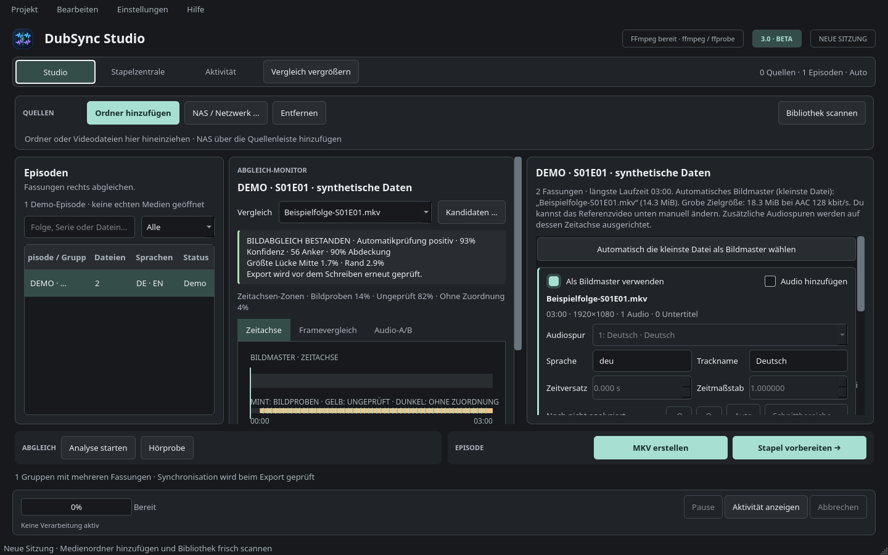
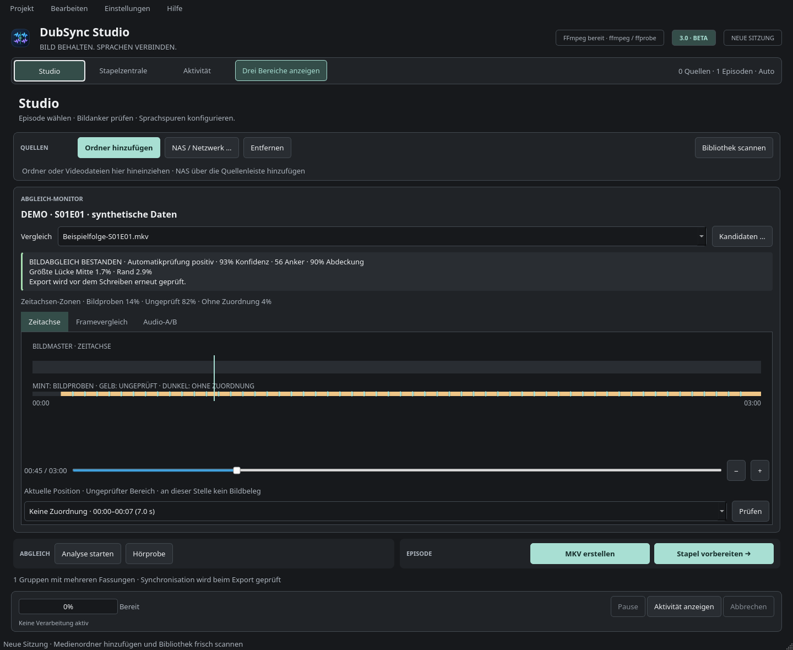
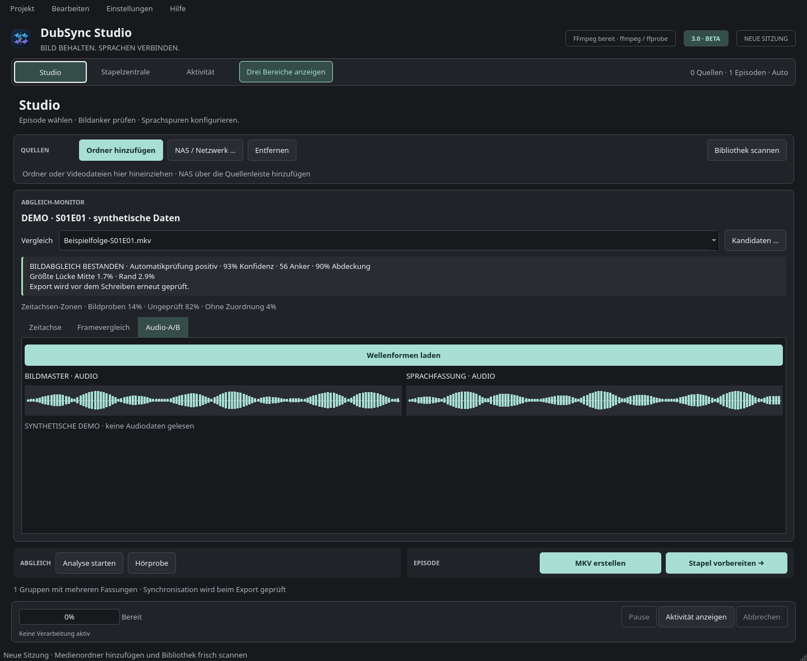
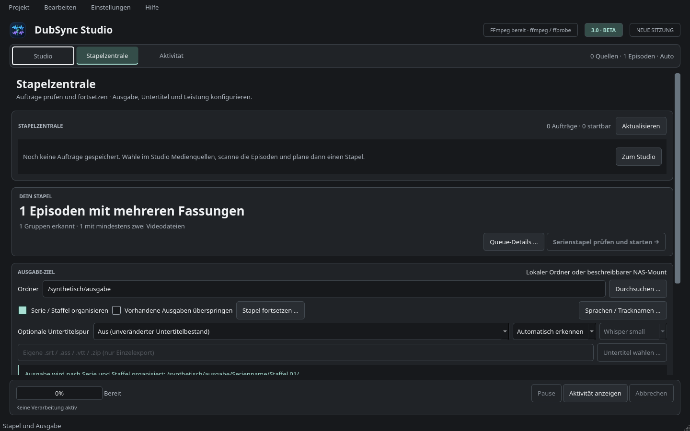
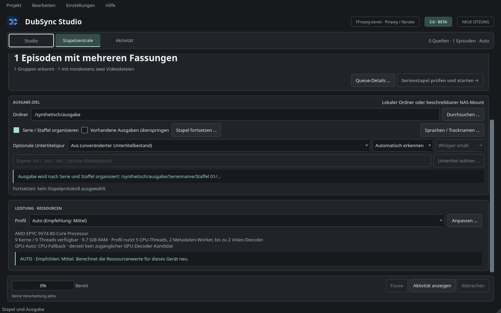

# DubSync Studio

**Keep the picture. Bring the languages together.**

DubSync Studio is a local, Linux-first desktop application for combining audio
from different language editions of a video. It matches **pictures**, not
dialogue, so differing intros, missing scenes and alternate cuts can be
reviewed before a multilingual MKV is created. Episodes can be processed
individually or as a season.

**Current release:** `3.0.0b1` (beta) · **Linux desktop** · Python / PySide6 / FFmpeg /
OpenCV / optional Rust · **MIT**



<sub>Actual PySide6 interface, captured with synthetic demonstration data.
The displayed match and timeline are not proof of a real-media export.</sub>

## Inside the Studio

| Focused image-evidence review | Optional audio A/B waveform review |
| :---: | :---: |
|  |  |
| **Persistent batch control** | **Performance presets** |
|  |  |

<sub>All images are real offscreen Qt captures with synthetic episode data.
Waveform shapes are illustrative; no source audio or NAS files were read.
See also the [compact 980 × 680 view](docs/screenshots/studio-compact-4.png).
The performance preview reflects the capture environment, not a hardware
benchmark. These images do not establish export success or physical QA.</sub>

## What it does

- **Visual synchronization:** frame fingerprints, drift compensation and
  independently checked scene segments; unmatched scenes remain silent rather
  than inventing audio.
- **Evidence-first review:** timeline zones, gaps, a status for the current
  cursor, on-demand two-frame comparison and optional short A/B listening.
  Image samples are **not** continuous verification.
- **Controlled export:** adds selected language tracks to an MKV while copying
  the original video; explicit preflight, verified output and no silent source
  modification or overwrite.
- **Season workflow:** episode candidate inspection, human-approved assignment,
  persistent queue, explicit retry/resume and NAS-aware error handling.
- **Optional subtitles:** switchable, non-burned-in SRT tracks from local or
  online sources; local transcription is the last resort in automatic mode.
- **Adaptive performance:** CPU/RAM-aware profiles, qualified GPU decoding,
  opt-in CPU calibration and a Rust matcher with NumPy fallback.

## Install and run

Requires **Python 3.10+**, **FFmpeg**, **FFprobe** and a Linux desktop.
Install the media tools with your distribution's package manager first.

```bash
git clone https://github.com/CopyPasteUser/dubsync-studio.git
cd dubsync-studio
./install-wizard.sh
```

For a local development run without a desktop launcher:

```bash
./setup.sh
./run.sh
```

Check dependencies without starting Qt: `./run.sh --doctor`.
For distribution notes and optional components, see
[Linux installation](docs/INSTALL_LINUX.md).

## Typical workflow

1. **Add folders** containing the language editions and scan the library.
   Filename grouping proposes candidates; it does not prove episode identity.
2. **Choose an episode** and verify the picture master and desired audio tracks.
   The smallest video is suggested as master, but can be changed manually.
3. **Analyze and review** image alignment, confidence and unverified gaps.
   Use `Alt+0` for a focused evidence monitor, and load frames or audio only
   when you need them.
4. **Export one episode or prepare a batch.** Each export gets a fresh safety
   preflight. Interrupted queued jobs require explicit resumption.

For audio inspection, **Hörprobe …** offers bounded 12-, 30- or 60-second A/B
windows with pause, stop and seeking. Optional continuation preloads the next
confirmed interval; a brief gap between windows is possible. A listening check
never grants export approval.

### Switchable subtitles

Under **Ausgabe-Ziel → Optionale Untertitelspur**, choose:

- **Off** (default), or a specific user-supplied subtitle.
- **Automatic:** local sidecars/archives and embedded text → SubDL (if
  configured) → Subliminal → local Whisper transcription as a last resort.
- **Find only:** search existing captions without transcription.
- **Online**, **video URL** (single export) or explicit **Generate**.

The added SRT track is **optional and non-default** in the resulting MKV; the
video is not re-encoded. Online captions and transcriptions can mismatch the
cut or timing and must be checked in a player. Optional subtitle timing
correction and a bounded private result cache are described in
[Subtitle sources, installation and safety](docs/SUBTITLES.md).

### Command-line inspection

```bash
./run.sh --scan-library "/mnt/nas/series/de" --scan-library "/mnt/nas/series/en"
./run.sh --queue-status --json
```

These commands **inspect only**; they do not analyze frames, export media or
resume queued work. JSON library scans can contain full private file paths.
More commands for episode candidates, Rust benchmarking, GPU/CPU diagnostics
and decoder tuning are in [Advanced workflows](docs/ADVANCED_WORKFLOWS.md).

## Safety boundaries

- A visually plausible intro or credits match cannot establish that two files
  are the same episode. Automatically approved alignments still require an
  independent export preflight.
- Unmapped video sections receive **silence**, not stretched or fabricated
  dialogue. Manual segment edits never become automatically verified.
- Source media is not changed. Output is staged and validated before promotion;
  existing files are never silently replaced.
- Analysis is local. Subtitle provider lookups and optional model downloads
  are network operations only when the corresponding options are used.

## Current status and documentation

`3.0.0b1` is a **development beta, not a certified stable 3.0 release**.
Automated checks and synthetic Qt previews cover many paths, but real Intel,
AMD and NVIDIA configurations, NAS failure recovery, wider desktop/scaling
coverage and physical audio playback remain release gates. A benchmarked Rust
stage does not imply the same end-to-end export speedup.

| Topic | Details |
| --- | --- |
| Development and UX priorities | [Studio overhaul](docs/STUDIO_OVERHAUL.md) · [3.0 roadmap](docs/ROADMAP_NEXT.md) |
| Reliability and release checks | [Release checklist](docs/RELEASE_CHECKLIST.md) · [GUI verification](docs/GUI_VERIFICATION.md) |
| Technical implementation | [Architecture](docs/ARCHITECTURE.md) · [Advanced workflows](docs/ADVANCED_WORKFLOWS.md) |
| Changes and security | [Changelog](CHANGELOG.md) · [Security](SECURITY.md) |

**Shortcuts:** `Alt+1` Studio · `Alt+2` Batch · `Alt+3` Activity ·
`Alt+0` Focused review · `Ctrl+F` Episode search.

---

Created by [CopyPasteUser](https://github.com/CopyPasteUser) with AI-assisted
development and human-directed product decisions. [MIT licensed](LICENSE).
