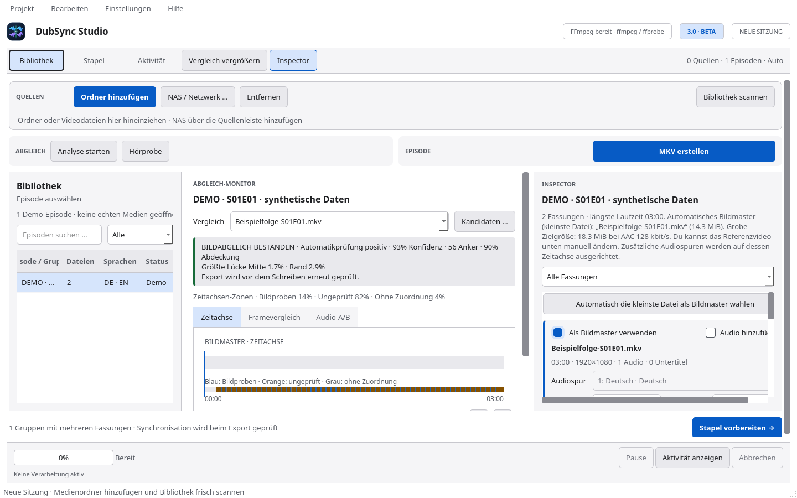
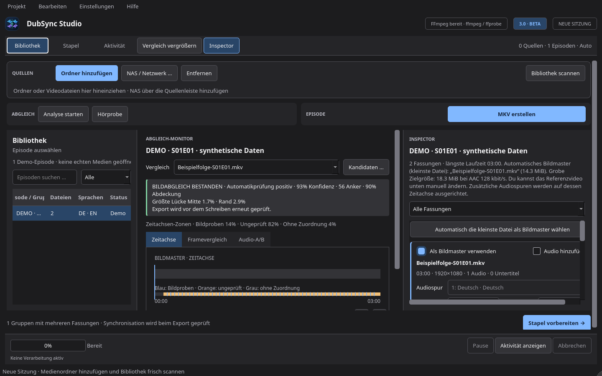

# Development status — 24 November 2026

**Released version: 3.0.0b1 (development beta).** The 4.0 development candidate was merged into `main` through [PR #37](https://github.com/CopyPasteUser/dubsync-studio/pull/37) at the maintainer's request. The application version metadata remains 3.0.0b1; this is not a 4.0 release.

[Integration branch](https://github.com/CopyPasteUser/dubsync-studio/tree/integration/4.0-studio) ·
[4.0 roadmap](https://github.com/CopyPasteUser/dubsync-studio/blob/integration/4.0-studio/docs/ROADMAP_4_0.md) ·
[Detailed acceptance evidence](https://github.com/CopyPasteUser/dubsync-studio/blob/integration/4.0-studio/docs/INTEGRATION_4_0.md)

## 4.0 candidate

Evidence snapshot: [`1928daf1ec18`](https://github.com/CopyPasteUser/dubsync-studio/commit/1928daf1ec18be4843e99d093f4a2e948e8d1b65).
At that revision, 52 commits and 53 changed files consolidated the original
five sprint PRs into one integration PR. These counts predate this
documentation refresh.

| Area | Implemented / verified scope |
| --- | --- |
| Performance | Bounded FFmpeg frame transport, consistent decoder thread budgets, validated master fingerprint reuse, compact batch journals |
| Export | Responsive cancellation, atomic no-clobber publication, source binding, continuous positive-delay audio clock |
| UI architecture | Extracted Qt components, indexed timeline, deferred queue refresh, cleanup of old button groups |
| Studio appearance | Light/dark/high-contrast palettes, library sidebar, review toolbar, collapsible and filterable inspector |
| Local subtitles | Real SRT mux acceptance, unchanged source hashes, copied master video, switchable extra track |
| Release engineering | Revision-pinned offline test and benchmark harness, screenshot generation in both appearances |

**Evidence:** 82 targeted tests and 110 subtests passed cumulatively on a
partially reconstructed, hash-verified workspace; not the full suite.
Local synthetic multitrack and section exports and subtitle muxing passed.
In those fixtures, reproduced positive-delay packet gaps of 458 ms and
958 ms were corrected to at most 1 ms of timestamp rounding. This is not
a claim of universal media compatibility.

| Isolated measurement | Result |
| --- | --- |
| FFmpeg frame transport messages | 53.1% fewer |
| Batch journal serialization | 7.65× faster |
| Batch journal size | 67.7% smaller |
| Master fingerprint cache lookup | approximately 63× faster |
| Timeline anchor projection | 306.6× faster |

These are component microbenchmarks, not whole-application speedups.
Full alignment, Rust/Qt regression, interactive visual review and real
GPU/NAS/desktop/audio acceptance remain open. The integration PR is merged (application merge commit `d2005e09590d516ac7a113726aab8961eb933f41`); no version bump or stable release has been made.

## Actual 4.0 screenshots





All twelve actual offscreen Qt screenshots supplied by the maintainer on
24 November 2026 are preserved in the [versioned gallery](screenshots/4.0/README.md).
The 3.0 captures and earlier [light](design/studio-4-light.svg) and
[dark](design/studio-4-dark.svg) design schematics remain historical references.
The captures establish rendering in both appearances; they do not establish
full interactive or physical UI acceptance. Compact layout remains dense.

## Reproduce 4.0 screenshots and finish acceptance

On a prepared Linux checkout of `main` with the project's
existing dependencies installed, run from the repository root:

```bash
./.venv/bin/python scripts/capture_studio_2.py --appearance light --output-dir docs/screenshots/4.0/light
./.venv/bin/python scripts/capture_studio_2.py --appearance dark --output-dir docs/screenshots/4.0/dark
```

Review all six screenshots per mode (review, focus, waveform, queue, hardware
presets, compact) before replacing the versioned gallery. Do not overwrite the
historical 3.0 captures or label a schematic as a real screenshot.

For full local acceptance, use the clean `main` checkout:

```bash
./.venv/bin/python scripts/acceptance_4_0.py
```

The report preserves all failures and skips and does not authorize a release.
No provider credentials or real media are required for the synthetic captures.
