# DubSync Studio 4.0 — SteamOS screenshots

Actual offscreen PySide6 captures with synthetic demo data, supplied by the maintainer on 24 November 2026 after installing the merged development candidate. All twelve original PNGs are preserved without editing. These images are not evidence of real-media synchronization or full interactive acceptance.

| View | Light | Dark |
| --- | --- | --- |
| Main workspace | 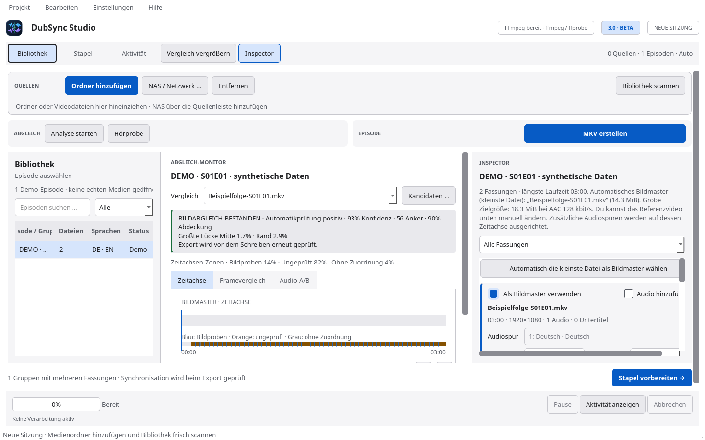 | 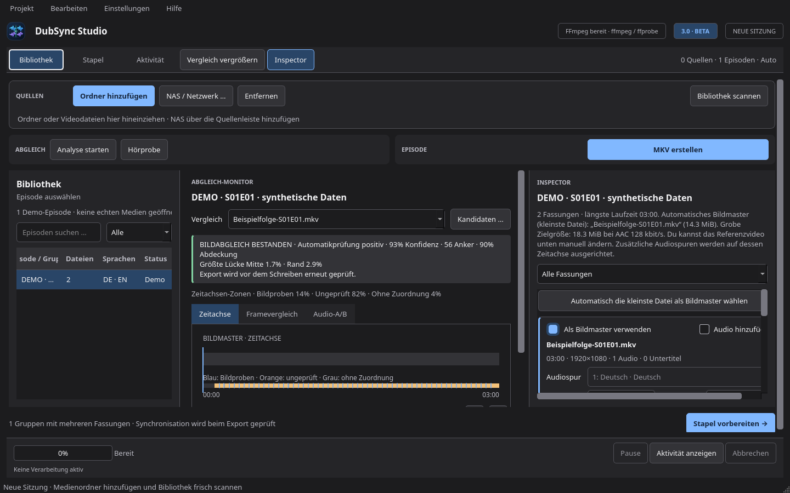 |
| Focused review | 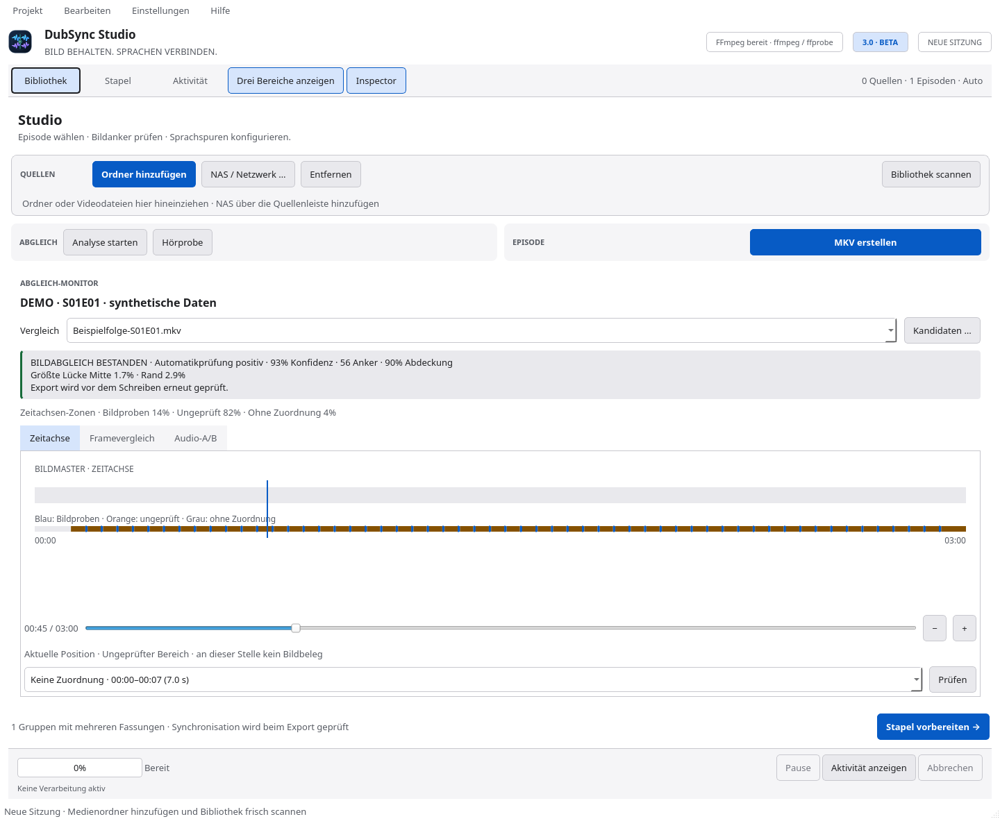 | 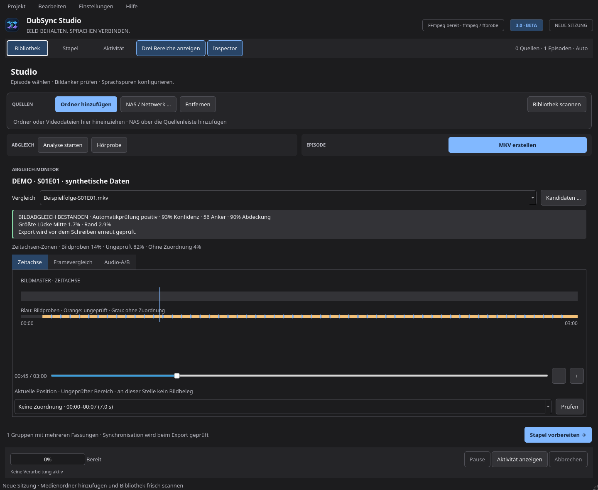 |
| A/B waveforms | 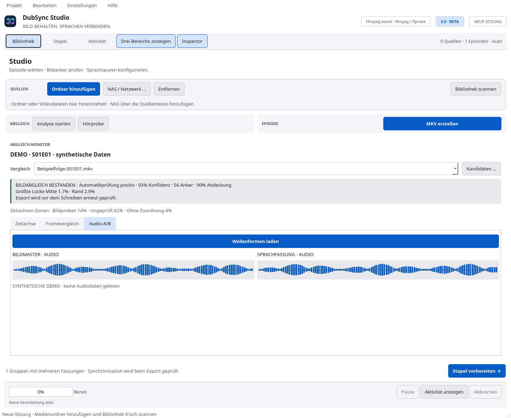 | 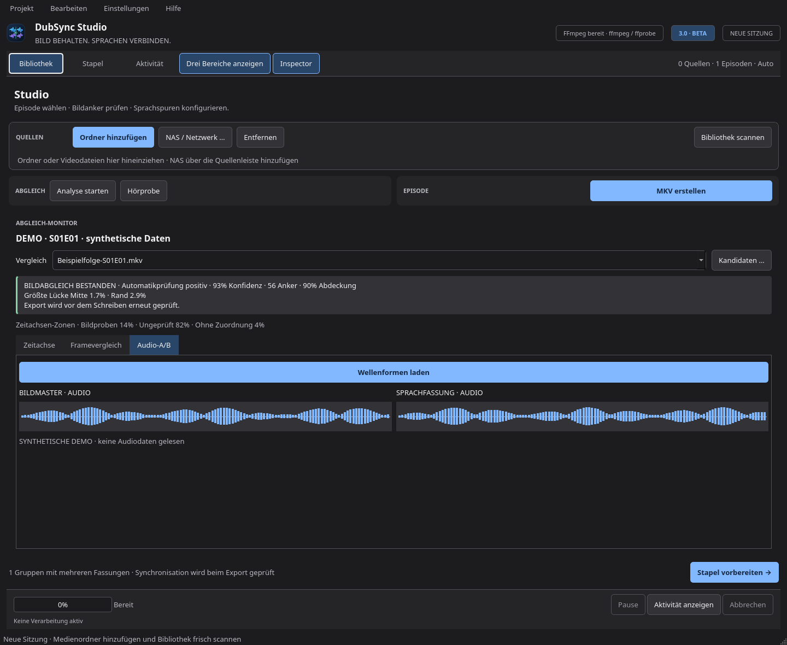 |
| Batch control | 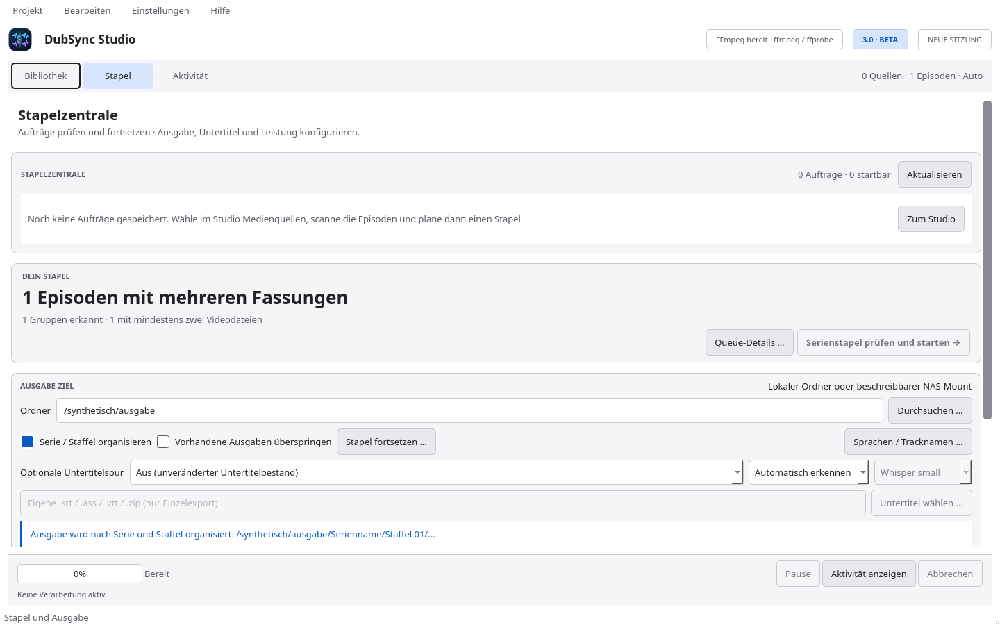 | 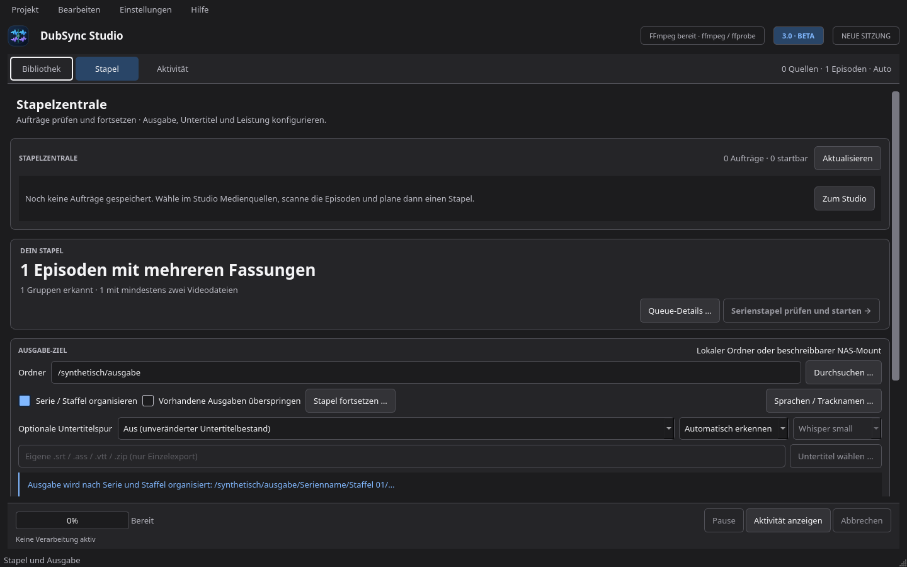 |
| Performance settings | 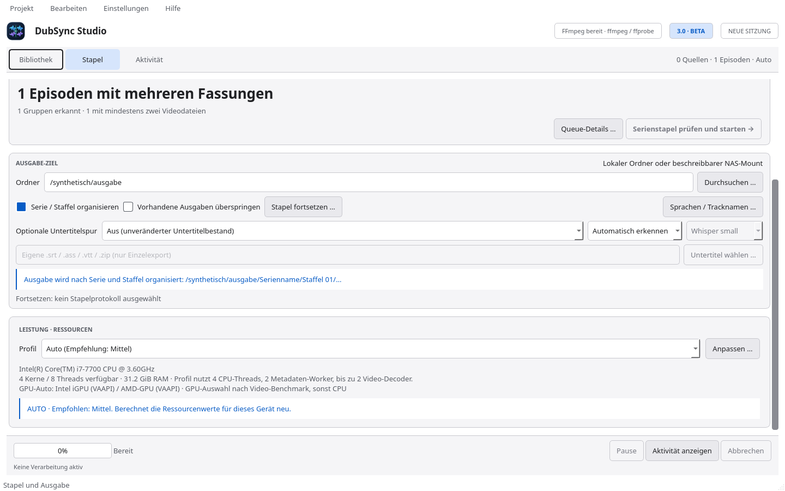 | 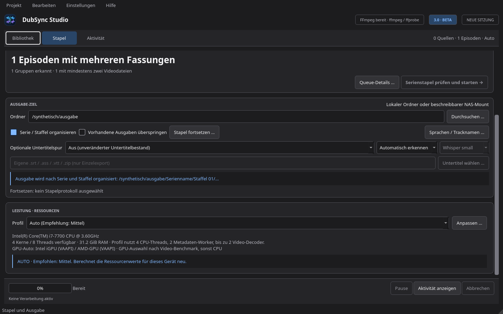 |
| Compact 980 × 680 | 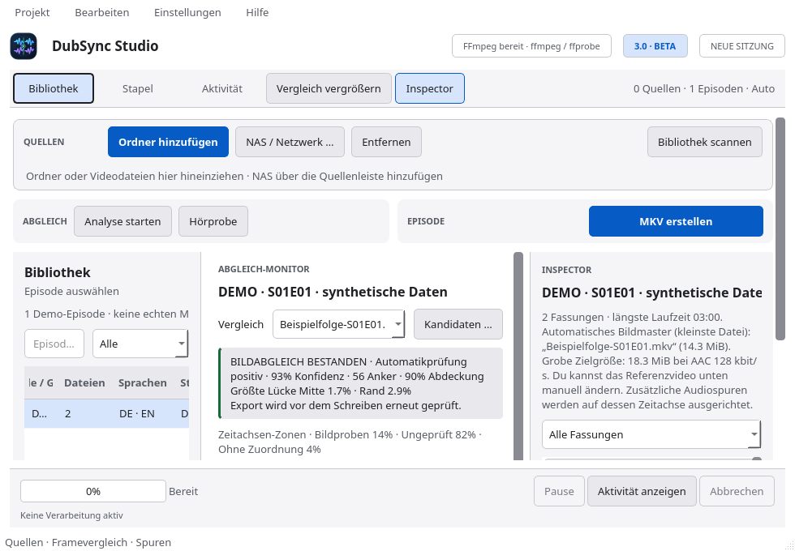 | 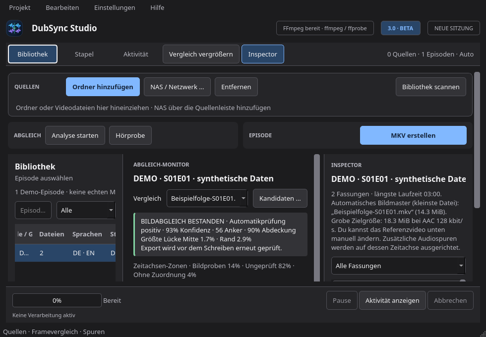 |

The compact layout is still dense and needs interactive review. See [GUI verification](../../GUI_VERIFICATION.md) and [current development status](../../DEVELOPMENT_STATUS.md).
